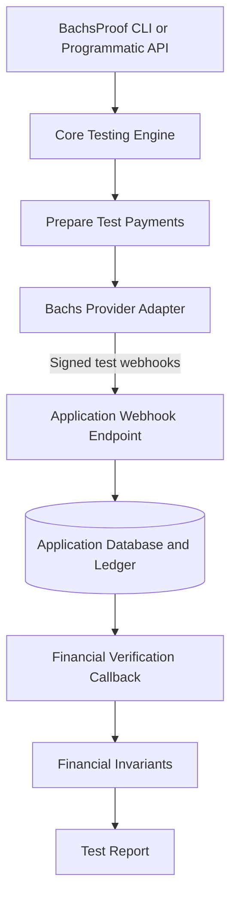

# BachsProof

**Payment correctness testing beyond HTTP responses.**

BachsProof is an independent, unofficial testing framework for Bachs integrations. It verifies payment handling from synthetic webhook delivery to committed database and ledger state; it is not affiliated with or endorsed by Bachs.

It helps developers detect duplicate credits, race conditions, incorrect payment fulfillment, and financial inconsistencies before they affect real users.

Bachs is its first supported payment provider.

## Why BachsProof?

A webhook returning HTTP `200` or `202` does not necessarily mean a payment was processed correctly.

Your application could acknowledge a webhook successfully while:

- Crediting a customer's wallet twice for the same payment.
- Crediting an incorrect amount or currency.
- Fulfilling an incomplete, expired, underpaid, or failed payment.
- Allowing older events to overwrite newer payment states.
- Incorrectly accepting tampered or unauthenticated webhooks.
- Producing inconsistent financial records under concurrent requests.

Consider a customer making a ₦5,000 deposit. Two identical webhook requests arrive concurrently:

```text
Request A reads payment status: PENDING
Request B reads payment status: PENDING

Request A credits ₦5,000
Request B credits ₦5,000

Expected credit: ₦5,000
Actual credit:   ₦10,000
```

Both requests may return successful HTTP responses, even though the application has created an incorrect financial outcome.

BachsProof helps detect these problems by generating controlled payment events, delivering them to your application, and verifying the financial state your application actually committed.

## Features

- **Payment lifecycle testing:** Simulate successful, incomplete, expired, underpaid, and failed payments.
- **Concurrency testing:** Deliver multiple webhooks concurrently to expose potential race conditions.
- **Idempotency testing:** Verify that repeated payment notifications do not create duplicate credits.
- **Financial verification:** Inspect committed database and ledger records rather than relying solely on HTTP responses.
- **Webhook security testing:** Test invalid signatures, tampered payloads, and malformed requests.
- **Automatic payment preparation:** Create isolated test payment records before executing scenarios.
- **Bachs integration:** Generate and sign synthetic Bachs webhook events using provider-specific fixtures.
- **JSON reports:** Generate machine-readable results for debugging and CI pipelines.
- **Programmatic API:** Integrate payment correctness tests into existing JavaScript and TypeScript test suites.
- **Optional checkpoint instrumentation:** Coordinate specific concurrent execution patterns for reproducible race-condition experiments.
- **Extensible provider architecture:** Support additional payment providers through provider adapters.

## Requirements

- Node.js 22 or later.
- npm or pnpm.
- An isolated application test environment.
- A reachable webhook endpoint.
- A test-only webhook signing secret, where applicable.
- Access to test payment or ledger records for financial verification.

BachsProof is database-agnostic. It does not require PostgreSQL, Prisma, Express, or any particular application framework.

> **Important:** Run BachsProof only against isolated, authorized test environments. Never use synthetic payment events against production systems or live payment credentials.

## Getting started

### 1. Install BachsProof

Using pnpm:

```bash
pnpm add -D @bachsproof/cli
```

Using npm:

```bash
npm install --save-dev @bachsproof/cli
```

> Public npm installation will be available once the packages are published. During development, BachsProof can be installed using locally generated package archives.

### 2. Initialize your project

```bash
pnpm exec bachsproof init
```

Or:

```bash
npx bachsproof init
```

BachsProof generates the following files:

```text
your-project/
├── bachsproof.config.mjs
└── tests/
    ├── bachsproof.test.mjs
    ├── bachsproof.setup.mjs
    └── bachsproof.verify.mjs
```

| File | Purpose |
| --- | --- |
| `bachsproof.config.mjs` | Configures the provider, webhook endpoint, signing, and test callbacks. |
| `bachsproof.test.mjs` | Contains payment test scenarios. |
| `bachsproof.setup.mjs` | Prepares isolated application payment records. |
| `bachsproof.verify.mjs` | Reads committed financial state after test execution. |

The generated setup and verification templates must be implemented for your application. They intentionally fail rather than return fabricated financial results.

### 3. Configure BachsProof

Set your test environment variables.

```env
BACHSPROOF_TARGET_URL=http://localhost:3000
BACHSPROOF_WEBHOOK_PATH=/webhooks/bachs
BACHS_WEBHOOK_SECRET=your-test-webhook-secret
```

Ensure these variables are loaded into the environment before running BachsProof.

Your configuration should look like this:

```javascript
import { bachsAdapter } from "@bachsproof/cli";
import { tests } from "./tests/bachsproof.test.mjs";
import { createPayment } from "./tests/bachsproof.setup.mjs";
import { verify } from "./tests/bachsproof.verify.mjs";

export default {
  provider: bachsAdapter({
    mode: "mock"
  }),

  target: {
    baseUrl: process.env.BACHSPROOF_TARGET_URL,
    webhookPath: process.env.BACHSPROOF_WEBHOOK_PATH
  },

  signing: {
    type: "bachs",
    secret: process.env.BACHS_WEBHOOK_SECRET
  },

  createPayment,
  verify,

  requireFinancialVerification: true,

  tests
};
```

BachsProof sends signed test webhooks to your existing application endpoint.

No additional production routes, inspection endpoints, or checkpoint middleware are required for ordinary testing.

### 4. Prepare test payments

Implement the `createPayment` callback inside `tests/bachsproof.setup.mjs`.

This callback creates an isolated payment record that your application can recognize when it receives a test webhook.

```javascript
export async function createPayment({
  scenario,
  amountMinor,
  currency,
  paymentIndex,
  paymentCount
}) {
  const payment = await testSupport.createIsolatedPayment({
    scenario,
    amountMinor,
    currency,
    paymentIndex,
    paymentCount
  });

  return payment.reference;
}
```

`testSupport.createIsolatedPayment()` is an illustrative application-specific helper, not a function provided by BachsProof.

You can implement payment preparation using your existing:

- Database client or ORM.
- Application services.
- Test fixtures.
- Repository methods.
- Isolated test APIs.

The callback must return a fresh payment reference understood by your application's webhook handler.

BachsProof automatically invokes this callback before executing the relevant scenario.

All monetary amounts are represented in integer minor units. For example, `500_000` kobo represents ₦5,000.

### 5. Implement financial verification

Implement the `verify` callback inside `tests/bachsproof.verify.mjs`.

This callback reads the financial records your application actually committed.

```javascript
export async function verify(reference, context) {
  const state =
    await testSupport.readCommittedFinancialState(reference);

  return {
    reference,

    creditCount: state.credits.length,

    creditedAmountMinor: state.credits.reduce(
      (total, credit) => total + credit.amountMinor,
      0
    ),

    currency: state.currency,
    status: state.status,
    pending: state.pending,
    ledgerEntries: state.credits
  };
}
```

`testSupport.readCommittedFinancialState()` is an illustrative application-specific helper. Implement it using your own database or ledger infrastructure.

The callback must return actual observed financial state, not expected values copied from the test configuration.

BachsProof compares this observed state against the expected financial outcome.

For asynchronous applications, return `pending: true` while relevant processing remains incomplete. BachsProof supports bounded polling and configurable observation windows to reduce the risk of premature passing results.

These observation windows do not guarantee that an erroneous credit cannot occur after testing ends.

### 6. Run your tests

Run all configured scenarios:

```bash
pnpm exec bachsproof test
```

Run a specific scenario:

```bash
pnpm exec bachsproof test --name "concurrent duplicate credit"
```

Generate a JSON report:

```bash
pnpm exec bachsproof test --json > bachsproof-results.json
```

BachsProof handles event generation, signing, delivery, scenario execution, financial verification, and reporting.

## Example output

```text
PASS sequential duplicate webhook
     Financially verified
     0 financial violations

PASS concurrent duplicate credit
     Financially verified
     0 financial violations

FAIL incomplete checkout
     Financially verified
     INV-004: Ineligible payment created 1 credit

Summary:
15 scenarios executed
14 passed
1 failed
15 financially verified
1 financial violation
```

The output above is illustrative. Actual results depend on your application, test configuration, and environment.

A successful webhook delivery does not automatically constitute a financial correctness pass.

## Supported scenarios

BachsProof currently provides 15 payment testing scenarios through its Bachs adapter.

| Scenario | What it tests | Expected outcome |
| --- | --- | --- |
| Sequential duplicate webhook | Repeated delivery of the same event | Exactly one credit |
| Concurrent duplicate credit | Overlapping duplicate webhook requests | Exactly one credit |
| Concurrent unique payments | Interference between independent payments | One credit per payment |
| Cross-event duplicate payment | Multiple event types representing one payment | Exactly one credit |
| Out-of-order events | Older events arriving after newer events | Valid payment remains fulfilled |
| Delayed payment confirmation | Successful confirmation arriving after an earlier event | Exactly one credit |
| Incomplete checkout | Checkout completed without collected payment | Zero credits |
| Expired checkout | Expired payment sessions | Zero credits |
| Tampered webhook | Payload modification after signing | Zero credits |
| Invalid webhook signature | Incorrect webhook authentication | Zero credits |
| Malformed webhook | Invalid request payloads | Zero credits |
| Incorrect payment amount | Payment amount mismatch | Zero credits |
| Incorrect payment currency | Payment currency mismatch | Zero credits |
| Underpaid payment | Payment below the required amount | Zero credits |
| Failed payment | Unsuccessful payment collection | Zero credits |

Expected HTTP responses can be configured separately from financial outcomes.

For example, an application may intentionally reject an unsupported event with HTTP `400`. BachsProof can verify that the response matches the application's contract while independently checking that no financial credit was created.

See the [scenario documentation](docs/scenarios.md) for detailed event definitions and expected outcomes.

## Financial invariants

Financial invariants are rules that must remain true regardless of how payment events are delivered or processed.

BachsProof evaluates the following invariants against observed application state:

| Invariant | Description |
| --- | --- |
| `INV-001` | A single financial payment must not create duplicate credits. |
| `INV-002` | A posted credit must match the expected amount and currency. |
| `INV-003` | An eligible payment must reach its expected credit count. |
| `INV-004` | An ineligible payment must not create a financial credit. |
| `INV-005` | The aggregate credited amount must match the expected payment amount. |

For scenarios involving multiple independent payments, BachsProof verifies each payment separately.

This prevents an over-credit on one payment from being hidden by an under-credit on another.

When `requireFinancialVerification` is enabled, missing or unsuccessful financial verification causes the test to fail.

BachsProof's conclusions depend on the completeness and accuracy of the financial state returned by the application's verification callback.

## How BachsProof works



BachsProof separates test orchestration, provider-specific behaviour, application processing, and financial verification.

The application remains responsible for its own payment processing, authentication, database transactions, idempotency, and financial integrity.

BachsProof evaluates the outcomes of those operations.

## Architecture

BachsProof is organized as a modular TypeScript monorepo.

| Package | Responsibility |
| --- | --- |
| `@bachsproof/core` | Scenario execution, concurrency coordination, financial invariants, verification, and reporting. |
| `@bachsproof/bachs` | Bachs event fixtures, payload normalization, amount handling, and webhook signing. |
| `@bachsproof/cli` | Project initialization, configuration loading, test execution, and terminal reporting. |
| `@bachsproof/sdk` | Optional test-only checkpoint instrumentation for controlled concurrency experiments. |

The repository also includes a reference wallet application demonstrating vulnerable and corrected payment processing implementations.

```text
BachsProof/
├── apps/
│   └── reference-wallet/
├── packages/
│   ├── core/
│   ├── bachs/
│   ├── cli/
│   └── sdk/
├── examples/
├── docs/
└── README.md
```

The checkpoint SDK is not required for ordinary CLI or programmatic testing.

## Concurrency testing

BachsProof supports two approaches to testing concurrent payment processing.

### Concurrent webhook delivery

BachsProof sends multiple webhook requests concurrently and inspects the resulting financial state.

This approach does not require modifications to the application under test.

It is useful for detecting duplicate credits, idempotency failures, and financial inconsistencies caused by overlapping requests.

However, concurrent delivery alone does not guarantee that a particular race condition will occur.

### Controlled checkpoint testing

For deeper concurrency experiments, BachsProof provides optional checkpoint instrumentation through `@bachsproof/sdk`.

Checkpoints allow developers to coordinate requests at specific points in a test-only application execution flow.

For example:

```text
Request A reads payment status: PENDING
Request B reads payment status: PENDING

Both requests reach the checkpoint.

BachsProof releases both requests.

Both requests attempt to process the payment.

BachsProof verifies the committed financial outcome.
```

This makes specific race-condition experiments more reproducible without claiming complete control over database, network, or operating-system scheduling.

Checkpoint instrumentation must remain restricted to test environments.

See the [checkpoint documentation](packages/sdk/README.md) for advanced usage.

## Experimental validation

BachsProof has been evaluated using both a controlled reference application and an independent fintech wallet backend.

### Reference wallet experiment

The reference wallet is an Express and Prisma application designed to demonstrate payment correctness failures.

It contains two payment processing implementations:

**Vulnerable implementation**

Uses an unsafe payment-processing sequence that can allow overlapping requests to create duplicate credits.

**Corrected implementation**

Uses transactional safeguards to prevent duplicate financial credits.

| Implementation | Expected credits | Observed credits |
| --- | ---: | ---: |
| Vulnerable handler | 1 | 2 |
| Corrected handler | 1 | 1 |

BachsProof detected the duplicate-credit violation in the vulnerable implementation and verified the corrected implementation.

The experiments included PostgreSQL-backed verification using a Railway-hosted test database.

Run the reference wallet experiment:

```bash
pnpm exec vitest run apps/reference-wallet/tests/wallet.integration.test.ts
```

Run the PostgreSQL-backed experiments with an isolated test database configured:

```bash
pnpm test:postgres
```

Skipped database tests must not be interpreted as successful database verification.

### Independent application testing — Norma

BachsProof was also integrated into Norma, an independent fintech wallet backend using Node.js, TypeScript, Prisma, and PostgreSQL.

Unlike the reference wallet, Norma was not originally built for BachsProof.

The integration used Norma's existing webhook endpoint, payment processing logic, database infrastructure, and ledger records.

No checkpoint instrumentation was required.

The experiments included:

- Installation of locally packaged BachsProof dependencies.
- Automatic creation of isolated test payment records.
- Execution of all 15 payment scenarios.
- Delivery of 100 concurrent duplicate webhooks for a single payment.
- Verification of committed wallet and ledger records.
- Detection of an unexpected financial credit.

#### Concurrent duplicate payment experiment

| Metric | Result |
| --- | ---: |
| Concurrent webhook deliveries | 100 |
| Original payment amount | ₦5,000 |
| Expected financial credits | 1 |
| Observed financial credits | 1 |
| Financial invariant violations | 0 |

Norma successfully prevented duplicate wallet credits during this experiment.

#### Incomplete checkout experiment

BachsProof generated a synthetic checkout completion event representing a checkout without a collected payment.

| Metric | Expected | Observed |
| --- | ---: | ---: |
| Financial credits | 0 | 1 |
| Credited amount | ₦0 | ₦5,000 |

BachsProof reported:

```text
FAIL incomplete checkout

INV-004: Ineligible payment created 1 credit
```

The issue was reproduced in a subsequent test.

Inspection of Norma's payment adapter identified that its NGN checkout completion handling could normalize an incomplete checkout into a confirmed deposit without sufficiently validating payment eligibility.

This demonstrates the importance of verifying financial outcomes rather than relying exclusively on successful webhook acknowledgments.

#### Overall experiment results

Following the initial suite execution and a successful rerun of a scenario affected by database connectivity:

| Outcome | Scenarios |
| --- | ---: |
| Scenarios executed | 15 |
| Passed | 8 |
| Financial invariant failure | 1 |
| Webhook delivery expectation failures | 6 |

The remaining delivery failures require further investigation against the application's supported event contracts and configured HTTP expectations.

Asynchronous verification behaviour also requires further validation.

These results represent development experiments using synthetic payment events and isolated test records. They do not establish live Bachs settlement behaviour or production readiness.

## Using BachsProof with Vitest

BachsProof complements existing testing frameworks such as Vitest and Jest.

Traditional testing frameworks provide general-purpose test execution, assertions, fixtures, mocking, and lifecycle management.

BachsProof provides payment-specific testing functionality, including:

- Provider-specific webhook generation.
- Webhook signing.
- Concurrent event delivery.
- Payment lifecycle scenarios.
- Financial invariant verification.
- Structured payment correctness reports.

A configured BachsProof instance can be used programmatically inside an existing test suite:

```javascript
const result = await bachsproof.run({
  scenario: "concurrent-duplicate-credit",
  reference: "isolated-order-001"
});

expect(result.passed).toBe(true);
expect(result.report.financiallyVerified).toBe(true);
```

This example assumes that the BachsProof instance, provider, target application, and financial verifier have already been configured.

Use the CLI for standalone payment testing or the programmatic API when integrating with an existing test suite.

## Continuous integration

BachsProof can be incorporated into CI pipelines to help detect financial correctness regressions.

```bash
pnpm exec bachsproof test
```

Generate machine-readable reports for automated processing:

```bash
pnpm exec bachsproof test --json > bachsproof-results.json
```

CI environments should use isolated application instances, test databases, and test-only credentials.

## Bachs integration

Bachs is BachsProof's first supported payment provider.

The Bachs adapter provides provider-specific synthetic event fixtures, webhook signing, amount normalization, and payment lifecycle scenarios.

BachsProof does not:

- Initiate live Bachs transactions.
- Collect or transfer money.
- Create real checkout sessions during ordinary mock testing.
- Verify Bachs' internal payment processing infrastructure.
- Guarantee that synthetic events reproduce every possible live provider behaviour.

Its purpose is to evaluate how an application handles payment events and their resulting financial outcomes.

See the [Bachs integration documentation](docs/bachs-integration.md) for provider-specific details.

## Limitations

BachsProof is an engineering testing tool, not a payment processor, reconciliation platform, or formal verification system.

Developers should understand the following limitations:

- Passing tests do not guarantee production readiness.
- Financial verification depends on accurate application-provided observations.
- Concurrent HTTP delivery does not guarantee deterministic race-condition reproduction.
- Controlled checkpoints coordinate specific execution patterns, not arbitrary system scheduling.
- Bounded observation windows cannot rule out financial errors occurring after the test completes.
- Synthetic webhook fixtures do not establish live provider settlement or retry behaviour.
- The current provider adapter supports Bachs.
- Application-specific payment preparation and verification callbacks are required for meaningful financial verification.

BachsProof should be used alongside unit tests, integration tests, security reviews, reconciliation processes, and appropriate production monitoring.

## Documentation

- [Getting started](docs/quickstart.md)
- [CLI usage](docs/cli.md)
- [Payment scenarios](docs/scenarios.md)
- [Financial invariants](docs/financial-invariants.md)
- [Bachs integration](docs/bachs-integration.md)
- [Controlled concurrency and replay](docs/replay.md)
- [Reference wallet engineering report](docs/engineering-demo.md)
- [PostgreSQL test setup](docs/railway-postgres.md)
- [Core API](packages/core/README.md)
- [CLI API](packages/cli/README.md)
- [Checkpoint SDK](packages/sdk/README.md)

## Local development

Clone the repository:

```bash
git clone https://github.com/therealEmma/BachsProof.git

cd BachsProof
```

Install dependencies:

```bash
pnpm install
```

Build the packages:

```bash
pnpm build
```

Run tests:

```bash
pnpm test
```

Run TypeScript checks:

```bash
pnpm typecheck
```

Validate and generate local package archives:

```bash
pnpm pack:check
```

Run the independent repository integration test:

```bash
pnpm exec vitest run examples/cli-independent-repository.test.ts
```

The package validation command generates local archives for testing and does not publish packages to npm.

## Contributing

Contributions that improve payment correctness testing, developer experience, financial verification, and provider support are welcome.

Areas for contribution include:

- Additional payment provider adapters.
- Payment lifecycle test scenarios.
- Financial invariant coverage.
- Concurrency testing improvements.
- Documentation and integration examples.
- Bug fixes and regression tests.

Provider-specific event fields and payment semantics should be based on documented provider contracts.

All contributions involving payment events must use isolated test environments and synthetic test data.

## License

A license has not yet been added to the repository. An explicit open-source license will be included before public package distribution.

---

**BachsProof — Verify the financial outcome, not just the HTTP response.**
