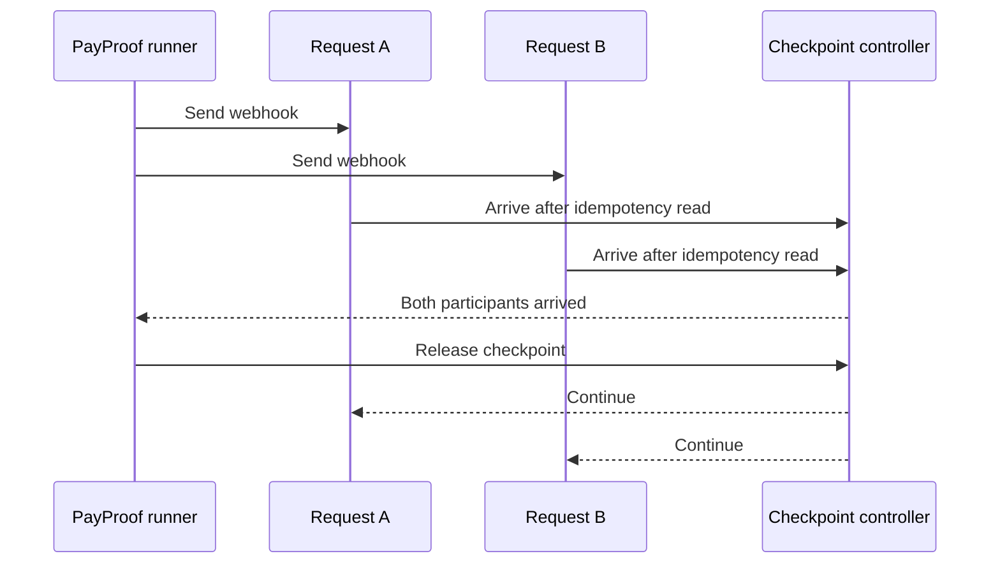

Sending requests together does not guarantee that both handlers reach the same
application line together. A checkpoint lets the application pause at a named
point while the PayProof controller waits for all participants.



Configure it on the runner:

```ts
checkpoint: {
  name: "after-idempotency-check",
  timeoutMs: 10_000
}
```

Then call `checkpoint("after-idempotency-check", { key: reference })` in a
test-only application path. The barrier is only enabled when the application
explicitly opts into the request headers.

This controls the named application point, not every scheduler, network, or
database detail. Report fields set `replay.controlled` to false when no
checkpoint is used.
