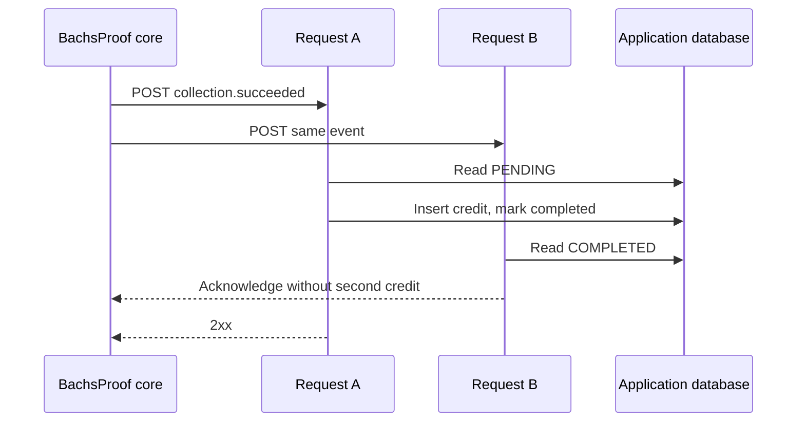
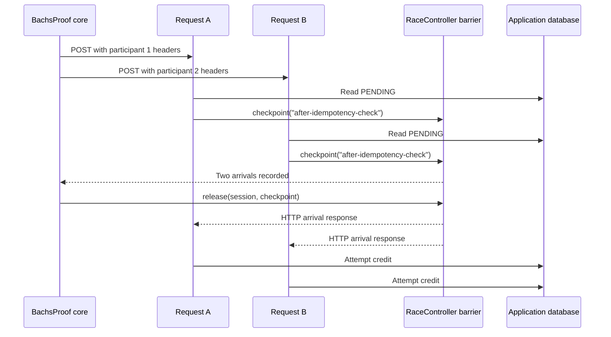

Start with a concrete race. A customer deposits ₦5,000. Two copies of the same
webhook arrive, and both handlers perform this unsafe sequence:

```text
read payment status -> see PENDING -> insert ₦5,000 credit -> mark COMPLETED
```

If both requests read `PENDING` before either transaction commits, the wallet
can contain two ₦5,000 credits. A correct application needs a transaction,
unique constraint, or equivalent atomic protection; a test barrier only makes
the dangerous interleaving easier to observe.

## Ordinary HTTP concurrency



The core starts both deliveries in one wave using `Promise.allSettled`. This is
real request overlap, but the OS, event loop, connection pool, and database may
let A finish before B reads. That is useful coverage, but it is not a promise
that both requests reached the same application line.

## A checkpoint is a starting gate

A **checkpoint** is a named point in application code. A **participant** is one
request registered for the run. A **barrier** is the rule that waits until the
configured participant count has arrived. A **race controller** is BachsProof's
small local HTTP server that records arrivals and releases the barrier.

Place the checkpoint after the idempotency read and before the credit write:



The requests are now both past the read before either is released. The barrier
does not wrap a database transaction, does not serialize the writes, and does
not make arbitrary scheduling deterministic.

## Configure it

```js
export default {
  // ...provider, target, verify, and tests...
  checkpoint: {
    name: "after-idempotency-check",
    timeoutMs: 10_000
  }
};
```

The core enables the checkpoint path only for
`concurrent-duplicate-credit`. It creates the `RaceController`, registers one
participant per `concurrency`, sends the requests, waits for arrivals, calls
`release`, records the trace, and cleans the session in `finally`.

## Express-style placement example

```ts
import express from "express";
import {
  checkpoint,
  checkpointMiddleware,
  configureCheckpoint
} from "@bachsproof/sdk";

const app = express();
const testMode = process.env.BACHSPROOF_TEST_MODE === "true";

configureCheckpoint({
  enabled: false,
  allowRequestHeaders: testMode
});

app.use(checkpointMiddleware({
  enabled: testMode,
  timeoutMs: 10_000
}));

app.post("/webhooks/bachs", express.json(), async (req, res) => {
  // These two functions are your application code. They read and write the
  // same isolated database used by the webhook in normal testing.
  const payment = await readPayment(req.body.data.reference);
  if (payment.status === "COMPLETED") return res.sendStatus(200);

  await checkpoint("after-idempotency-check", { key: payment.reference });

  await creditPaymentAtomically(payment);
  return res.sendStatus(200);
});
```

This is a placement example, not a copy-paste application. Replace
`readPayment` and `creditPaymentAtomically` with your own functions. The rest
of the checkpoint setup can be copied into an Express test build.

Line by line:

- The SDK imports are optional test instrumentation; the application can run
  without them in ordinary black-box mode.
- `testMode` is an explicit environment switch. Keep it false in production.
- `configureCheckpoint` refuses request-header activation unless the test
  process opts in. `enabled: false` avoids a process-wide credential context.
- `checkpointMiddleware` reads the request-scoped controller details and stores
  them with `AsyncLocalStorage`. It does nothing when either switch is off.
- The handler reads payment state first. That is the race point we want both
  requests to reach.
- The named `checkpoint` announces the participant and waits for the core's
  release. The `key` is trace metadata; it is not a lock.
- `creditPaymentAtomically` still needs real transaction/uniqueness protection.
  The checkpoint cannot replace it.

## Waiting, release, and timeout behavior

`checkpoint(name)` sends an authenticated `POST` to the controller's
`/sessions/{session}/checkpoints/{name}/arrive` endpoint. The body contains the
participant ID and optional key/metadata. The controller rejects unknown
participants, duplicate arrivals, bad tokens, and malformed routes.

The core's `waitForArrivals` resolves when the required count is present. The
core then calls `release`; the controller completes the held arrival responses.
If the count is not reached by `timeoutMs`, the core records an arrival timeout,
aborts the session, and completes waiting participants with a conflict response
so they do not hang forever. The trace records arrivals, release, or abort.

## Controlled-execution limits

- It coordinates only the named checkpoint.
- It does not control the database isolation level or lock scheduling.
- It does not prove behavior after the checkpoint or after the observation
  deadline.
- It is local test instrumentation, not a distributed lock, auth mechanism, or
  production failover strategy.
- The application must reach the checkpoint in every participant or the test
  will time out.

Use ordinary concurrency first. Add a checkpoint when you need to reproduce a
specific application-level interleaving and can explain why that placement
matters.
