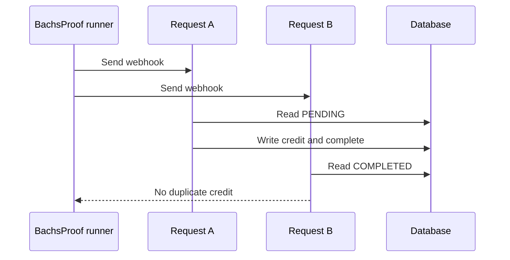
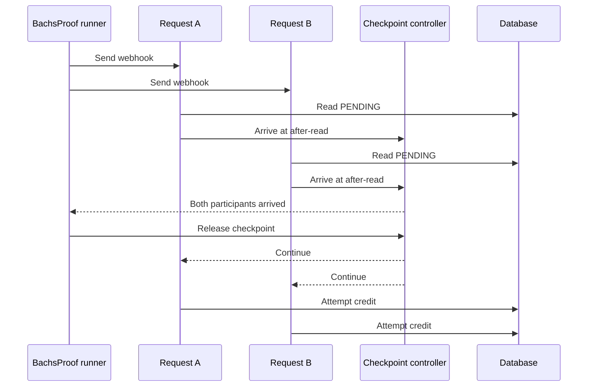

## Why ordinary concurrency is not enough

Sending two requests in the same JavaScript turn does not guarantee that both
handlers reach the same line together. The operating system, Node event loop,
HTTP connection, database pool, and database scheduler all influence the
interleaving.

For a duplicate ₦5,000 deposit, ordinary mode may happen like this:



That is a useful real HTTP test, but it may miss the vulnerable interleaving.

## What a checkpoint changes

Put a named checkpoint after the application reads idempotency state:



The checkpoint is like a starting gate: participants wait until everyone has
reached the gate, then the controller opens it. It does not make the database
safe. A unique constraint, transaction, or equivalent atomic design must still
allow only one credit.

Configure the runner:

```ts
checkpoint: {
  name: "after-idempotency-check",
  timeoutMs: 10_000
}
```

The core creates a local `RaceController`, registers participants, sends the
webhooks with checkpoint headers, waits for arrivals, releases the named
checkpoint, records the trace, and cleans up the session. The controller is an
HTTP service so a separate application process can participate.

## What it can and cannot guarantee

Controlled mode can make the named instrumented point repeatable and records
which participants arrived. It cannot make all operating-system, network,
connection-pool, or database scheduling deterministic. It is test-only and
should be used after ordinary black-box delivery is working.
