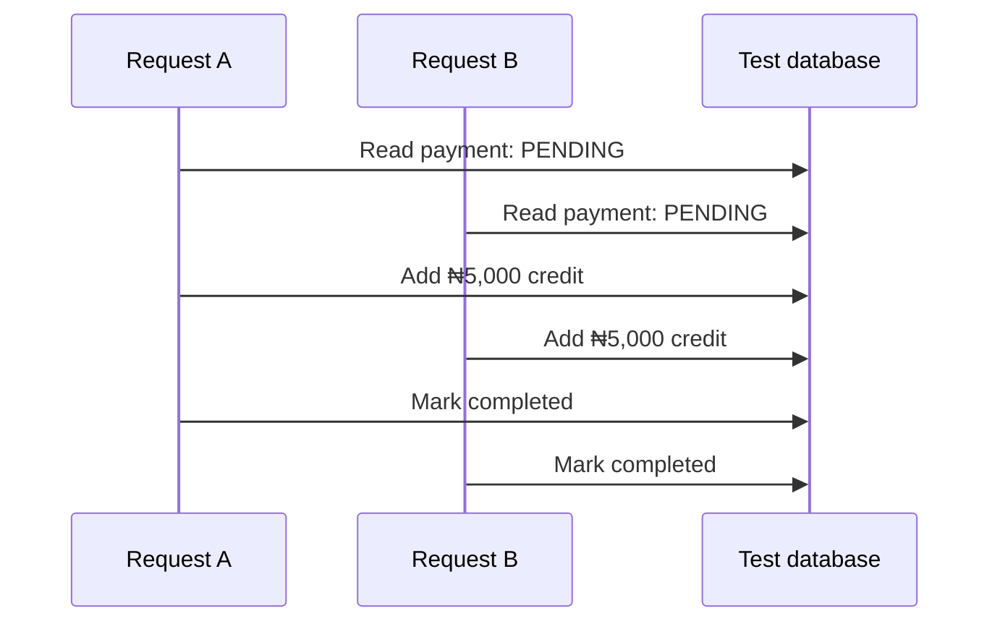

This case study uses the checked-in `apps/reference-wallet` application. It
shows what BachsProof can prove about one isolated application, not about every
payment system.

## The simple story

Imagine a customer deposits **₦5,000**. The application should create one
credit of `500_000` kobo. Two copies of the same webhook arrive together.

The vulnerable handler does this:

```text
read payment status
if it is not completed, add a credit
mark the payment completed
```

Both requests can read `PENDING` before either request saves `COMPLETED`:



The wallet ends with two credits, or **₦10,000**, even though the customer paid
once. Both HTTP requests may still return `200`.

## What BachsProof checks

The test sends one synthetic `collection.succeeded` event twice at the same
time. The optional checkpoint pauses both requests after they read `PENDING` and
releases them together. The `verify` callback reads the committed credits from
the application store. BachsProof then checks the observed result against its
financial rules.

| Handler | Expected credits | Observed credits | Result |
| --- | ---: | ---: | --- |
| Vulnerable | 1 | 2 | Fails `INV-001` |
| Corrected | 1 | 1 | Passes |

This is a financial test: the result comes from committed application state,
not from the HTTP status alone.

## How the corrected version works

The corrected path protects two different identities:

1. The provider event ID identifies one delivery, so the same delivery can be
   recognized again.
2. A business idempotency key derived from the payment reference identifies the
   financial payment, so two different event types cannot create two credits.

In the PostgreSQL store, one database transaction re-reads the payment, checks
the amount and currency, records the event, adds the unique credit, updates the
wallet, and marks the payment complete. These changes commit together or roll
back together. The in-memory store uses a synchronous critical section for its
fast test; it is not a replacement for the PostgreSQL transaction.

The checkpoint is outside that transaction. It helps create the test schedule;
it is not a database lock and cannot replace the transaction or unique key.

## Run the experiment

Fast in-memory test:

```bash
pnpm exec vitest run apps/reference-wallet/tests/wallet.integration.test.ts
```

This test proves that the vulnerable handler records two credits and that the
corrected handler records one under the same controlled schedule.

The story above uses ₦5,000 (`500_000` kobo) because it is easy to follow. The
checked-in integration test omits `amountMinor`, so the current adapter default
is `5_000_000` minor units, or ₦50,000 at two decimal places. That difference
does not change the duplicate-credit result. Set `amountMinor: 500_000` when
you need the exact ₦5,000 example in a custom run.

PostgreSQL test:

```bash
pnpm exec vitest run apps/reference-wallet/tests/wallet.postgres.integration.test.ts
```

The PostgreSQL tests run only when `DATABASE_URL` is configured. If it is not
configured, Vitest skips them. A skipped database test is not a passing database
result.

The tests use unique references and clean up only their own records. They do not
call Bachs, create a live checkout, or move money.

## What this does not prove

- It does not prove that another application's schema or transaction design is
  correct.
- It does not prove live Bachs settlement, retries, or provider infrastructure.
- It does not control every operating-system, network, or database schedule.
- It does not make a finite observation window a permanent guarantee.
