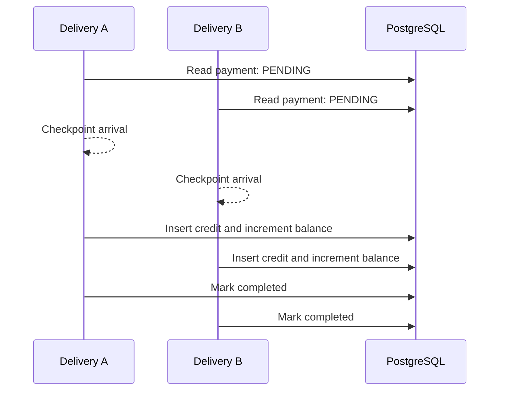

The reference wallet is a small Express application with the same
`/webhooks/bachs` route in both modes:

- `vulnerable`: reads payment state, waits at a checkpoint, then writes an
  unrestricted credit;
- `corrected`: performs event identity, payment matching, idempotent credit,
  balance update, and payment completion inside one Prisma transaction.

It exists to prove that BachsProof can fail a real persisted implementation and
then pass the corrected implementation under the same controlled schedule.

## The vulnerable sequence



The result is two committed `WalletCredit` rows for one payment. The
checkpoint is outside the transaction, so it does not hold a database
transaction open while waiting.

## The corrected strategy

The corrected path uses two identities:

1. `WebhookEvent.eventId` deduplicates one provider delivery.
2. `WalletCredit.idempotencyKey` is `bachs:payment:<reference>`, so distinct
   provider events for one financial payment cannot create distinct credits.

Inside the transaction, `PrismaWalletStore.processCorrected` re-reads the
payment, checks customer/currency/amount, records event identity, protects
completed state from older events, inserts the unique credit, increments the
wallet, and updates payment/event state. A concurrent unique-key loser is
reconciled as an idempotent duplicate.

The in-memory store has an intentionally unsafe method for the demonstration
and a synchronous critical section for the corrected fast test. It is not a
replacement for the PostgreSQL transaction.

## Reproduce it

Fast in-memory experiment:

```bash
pnpm exec vitest run apps/reference-wallet/tests/wallet.integration.test.ts
```

PostgreSQL experiment with a supplied `DATABASE_URL`:

```bash
pnpm exec vitest run apps/reference-wallet/tests/wallet.postgres.integration.test.ts
```

The PostgreSQL suite is skipped when `DATABASE_URL` is absent; a skipped test
is not a pass. The test files create scoped references and clean up only their
own records.

## Repository evidence

The repository's recorded experiment reports the vulnerable in-memory wallet
failing with two committed credits and `INV-001`, the corrected in-memory path
passing with one credit, and the PostgreSQL tests detecting the duplicate in
vulnerable mode and committing one credit in corrected mode when PostgreSQL is
available. These results apply to this reference wallet and its test data, not
to another application's schema or production deployment.
