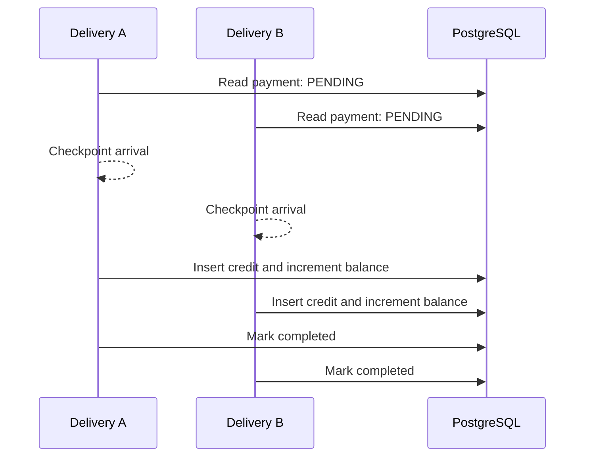

The reference wallet is a small Express application with two persistence modes:

- `vulnerable`: checks payment state, waits at a checkpoint, then writes an
  unrestricted credit;
- `corrected`: performs event identity, payment matching, idempotent credit,
  balance update, and payment completion inside one Prisma transaction.

It exists to prove that PayProof can fail a real persisted implementation and
then pass the corrected implementation under the same schedule.

## The vulnerable sequence



The result is two committed `WalletCredit` rows for one payment. The
checkpoint is outside the transaction, so it does not hold a database
transaction open while waiting.

## The corrected strategy

The corrected path uses two identities:

1. `WebhookEvent.eventId` deduplicates one provider delivery.
2. `WalletCredit.idempotencyKey` is derived from the local payment reference,
   so two distinct provider events for one financial payment cannot create two
   credits.

Inside the transaction it re-reads the payment, validates customer/currency/
amount, records event identity, protects completed state from older events,
inserts the unique credit, increments the wallet, and marks both payment and
event state.

## Reproduce it

The fast in-memory experiment:

```bash
pnpm exec vitest run apps/reference-wallet/tests/wallet.integration.test.ts
```

The PostgreSQL experiment uses a supplied `DATABASE_URL`, checked-in Prisma
migrations, unique per-run references, and scoped cleanup:

```bash
pnpm exec vitest run apps/reference-wallet/tests/wallet.postgres.integration.test.ts
```

The suite is skipped when `DATABASE_URL` is absent; a skipped database test is
not treated as a pass.

## Observed repository evidence

The validated run in this repository showed:

| Experiment | Result |
| --- | --- |
| Vulnerable in-memory wallet | Failed as expected with two committed credits and `INV-001` |
| Corrected in-memory wallet | Passed with one committed credit |
| Sequential duplicate and replay | Passed |
| Callback verification | Passed |
| Vulnerable PostgreSQL wallet | Detected duplicate committed credits |
| Corrected PostgreSQL wallet | Committed exactly one credit |

This proves the tested race and database behavior for this reference wallet. It
does not prove that another application has the same transaction boundaries or
schema.
