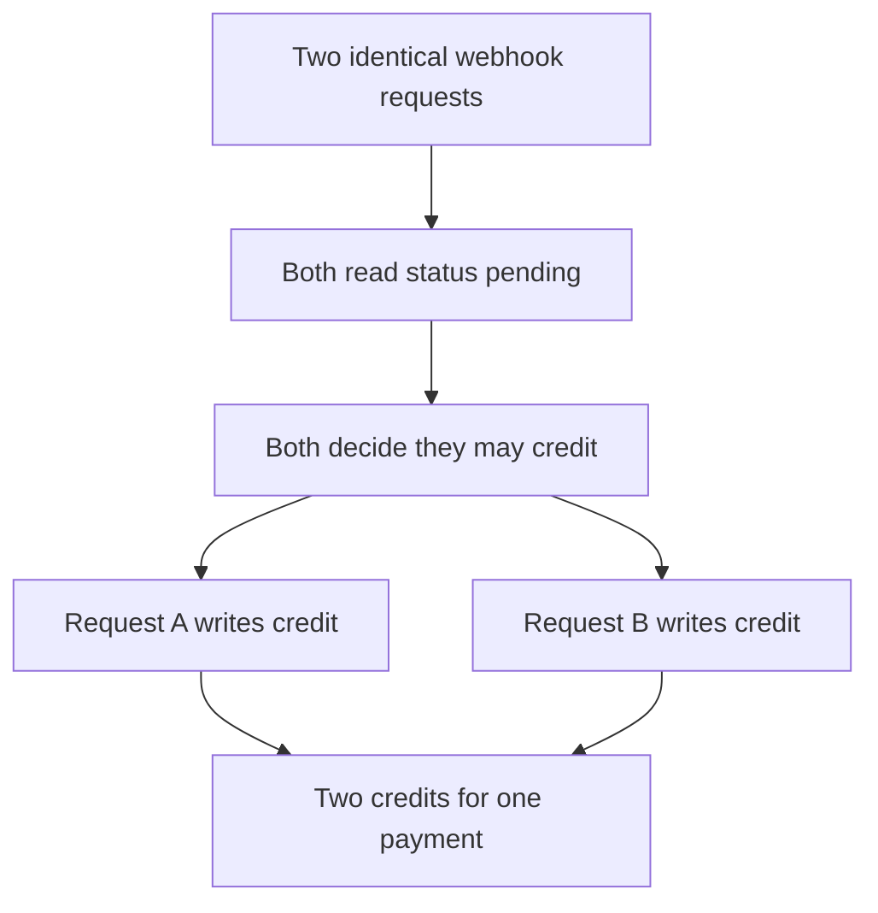

Concurrency means that two pieces of work overlap in time. A race condition
appears when the result depends on which request happens to reach a line first.

PayProof has two modes:

- **Black-box concurrency:** the runner sends a required delivery wave with
  `Promise.allSettled`. This is realistic HTTP concurrency but not deterministic
  scheduling.
- **Controlled concurrency:** the optional checkpoint SDK pauses requests at a
  named application point. The runner releases the participants together.

Only the second mode can make a particular application interleaving repeatable;
even it does not control every operating-system, network, or database detail.
