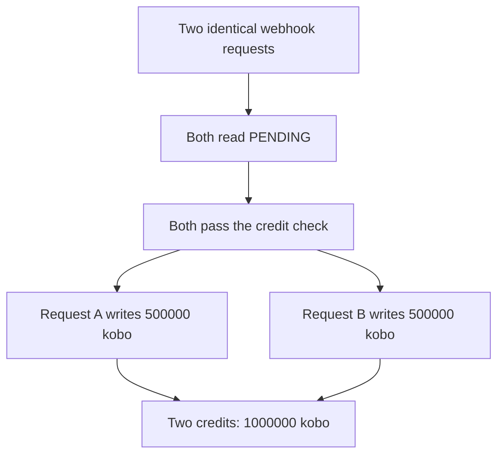

Concurrency means that two pieces of work overlap in time. A race condition
appears when the result depends on which request happens to reach a line first.

For a ₦5,000 deposit, a vulnerable handler might do this:

1. Request A reads “payment is pending.”
2. Request B reads “payment is pending” before A commits.
3. Both decide they are allowed to credit.
4. Both insert a `500_000`-kobo credit.

The wallet can now show ₦10,000 even though both HTTP requests returned `200`.

BachsProof has two modes:

- **Black-box concurrency:** the runner sends a delivery wave with
  `Promise.allSettled`. This is real HTTP overlap, but scheduling is not
  deterministic.
- **Controlled concurrency:** the optional checkpoint SDK pauses requests at a
  named application point and the core releases the participants together.

Sending two requests “at the same time” does not guarantee that both handlers
reach the same line at the same time. Controlled mode makes the named arrival
point repeatable, but it does not control every OS, network, or database detail.
