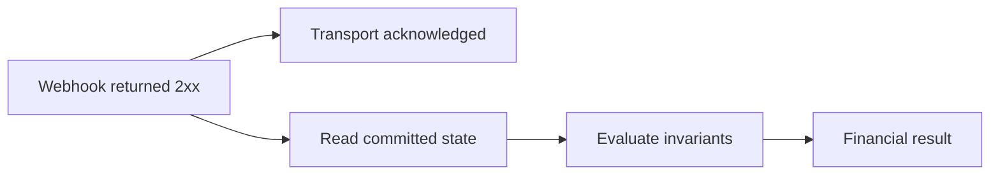

An application is financially correct for a tested condition when its committed
state matches the business rule for that condition.

For an eligible NGN 5,000 payment, that usually means one credit of NGN 5,000.
For an expired, failed, or underpaid payment, it usually means zero credits.

PayProof never treats an expected outcome as proof. The expected outcome tells
the runner what to compare against; `verify` must independently read what the
application committed.

See the [financial invariant reference](/financial-invariants) for the exact
checks and violations.
