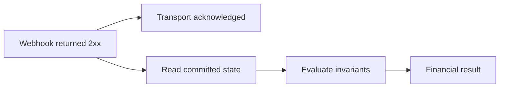

An application is financially correct for a tested condition when its committed
state matches the business rule for that condition.

For an eligible NGN 5,000 payment, that normally means one credit of `500_000`
minor units. For an expired, failed, or underpaid payment, it normally means
zero credits. The exact business rule still belongs to the application.

These are different questions:

| Question | Evidence |
| --- | --- |
| Did the request reach the route? | Delivery status and response body |
| Did the application save the right money state? | Independent `verify` read |
| Did the saved state obey BachsProof's rules? | `verification.violations` |

BachsProof never treats an expected outcome as proof. The expected outcome tells
the runner what to compare against; `verify` must independently read what the
application committed. See the [financial invariant reference](/financial-invariants)
for the exact checks.
