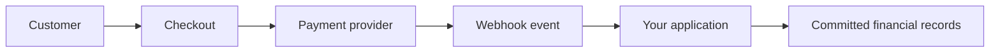

A digital payment is not one instant. It is a chain of state changes shared by
the customer, the provider, and your application.

The browser may show a success page, but the application should decide whether
to fulfil an order or credit a wallet from verified provider state received by
the server.

## A concrete example

1. Your application creates an order for NGN 5,000.
2. The customer completes checkout.
3. The provider collects or fails to collect the money.
4. The provider sends an event describing what happened.
5. Your application authenticates the event, matches it to the order, and
   commits the financial result.

The important engineering question is not merely “did the provider send an
event?” It is “what state did our application commit after processing it?”

## Where correctness bugs appear

Failures often come from retries, simultaneous requests, wrong amounts, stale
events, incomplete payments, or a database write that is not atomic with the
idempotency decision. PayProof focuses on those boundaries.
