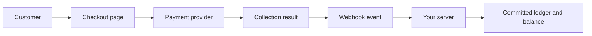

A digital payment is not one instant. It is a chain of state changes shared by
the customer, the provider, and your application.

## A ₦5,000 wallet deposit

Imagine a customer wants to add ₦5,000 to a wallet:

1. Your application creates an order or payment record for `500_000` kobo.
2. Your server creates or displays a provider checkout.
3. The customer tries to pay. The attempt may succeed, fail, or be incomplete.
4. The provider sends a server-to-server event describing the state it knows.
5. Your webhook authenticates the event and matches its reference to the order.
6. Your database transaction records one financial effect and updates the wallet.

The browser's success page is only a user-interface signal. The server should
decide whether to fulfil from authenticated provider state and the application's
own order, amount, and currency checks.

## Why tests need more than an HTTP assertion

An endpoint test can confirm that a route returned `200`. It cannot see whether
the handler wrote two credits, credited the wrong wallet, used the wrong
currency, or accepted an expired payment. BachsProof sends the event over the
real HTTP boundary and can then call your test-side `verify` function to read
the committed result.

These are test fixtures, not live Bachs payments. Use a provider sandbox when
you need evidence about checkout creation, settlement, or provider retries.
