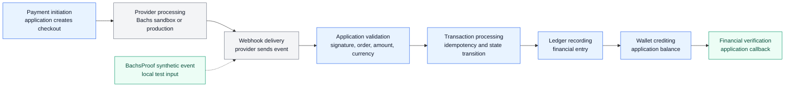

A payment has provider-side and application-side stages. A completed checkout
or a successful webhook delivery does not by itself prove that the application's
wallet and ledger are correct.

The highlighted application stages are the boundary BachsProof helps exercise:
the application validates the event, processes it safely, records the ledger
effect, credits the wallet when appropriate, and returns observed state through
the verification callback. The adapter may inject a synthetic event at the
webhook boundary; it does not perform provider processing or settlement.

## Provider lifecycle signals

The current Bachs adapter represents these one-time payment signals:

| Signal | Plain meaning | Eligible in the current adapter? |
| --- | --- | --- |
| `checkout.completed` | The checkout flow finished; it may still have no collected charge | Only when it is a paid payment checkout with a charge |
| `checkout.expired` | An open checkout expired | No |
| `collection.succeeded` | The provider reports a successful collection | Yes |
| `collection.underpaid` | Less than the expected amount arrived | No |
| `collection.failed` | A collection attempt failed | No |

For a **₦5,000** wallet deposit, `checkout.completed` by itself is not
permission to add `500_000` kobo. The application must match provider state to
its own order and decide whether the payment is eligible. These are synthetic
fixtures based on documented event names; they do not prove live settlement.

See the official [Bachs checkout guide](https://docs.bachs.io/guides/checkout/checkout-sessions)
for the provider-side flow and webhook confirmation responsibilities.
