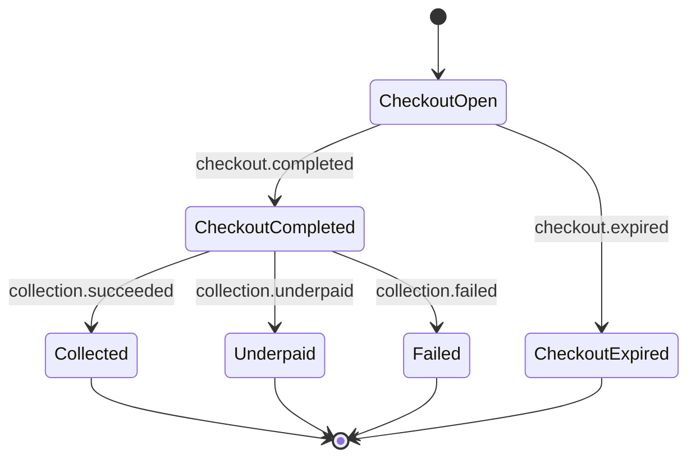

PayProof models the Bachs lifecycle signals that are implemented by the current
adapter:

| Signal | Plain meaning | Eligible for the reference wallet? |
| --- | --- | --- |
| `checkout.completed` | A checkout finished; it may or may not contain a collected payment | Only when the fixture says it is paid and has a charge |
| `checkout.expired` | An open checkout expired | No |
| `collection.succeeded` | A payment collection succeeded | Yes |
| `collection.underpaid` | Less than the expected amount arrived | No |
| `collection.failed` | A collection attempt failed | No |

The adapter tests the distinction between a completed checkout and a collected
payment. A checkout completion alone is not permission to credit a wallet.

These are test fixtures based on documented Bachs event types. They are not
live provider state and do not prove settlement.
