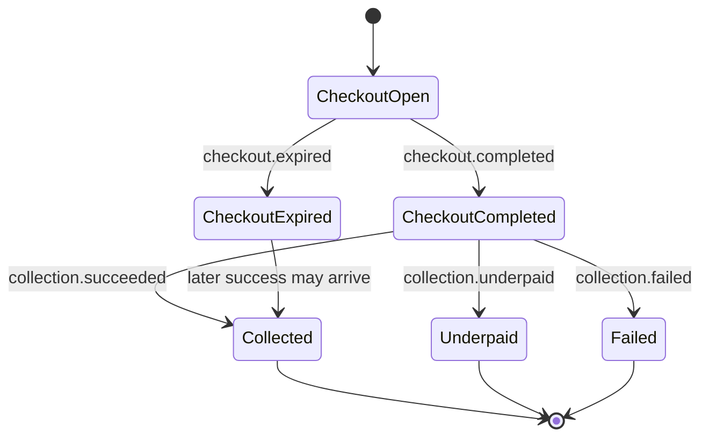

The customer may see “checkout completed” before your application has evidence
that money was collected. BachsProof therefore keeps lifecycle signals separate
from the final fulfilment decision.

| Signal | Plain meaning | Eligible in the current adapter? |
| --- | --- | --- |
| `checkout.completed` | The checkout flow finished; it may still have no charge | Only when it is a paid payment checkout with a charge |
| `checkout.expired` | An open checkout expired | No |
| `collection.succeeded` | The provider reports a successful collection | Yes |
| `collection.underpaid` | Less than the expected amount arrived | No |
| `collection.failed` | A collection attempt failed | No |

For a ₦5,000 wallet deposit, `checkout.completed` by itself is not permission
to add `500_000` kobo. The application must match the provider state to its
own order and decide whether the payment is eligible. These are synthetic
fixtures based on the documented event names; they do not prove live settlement.
