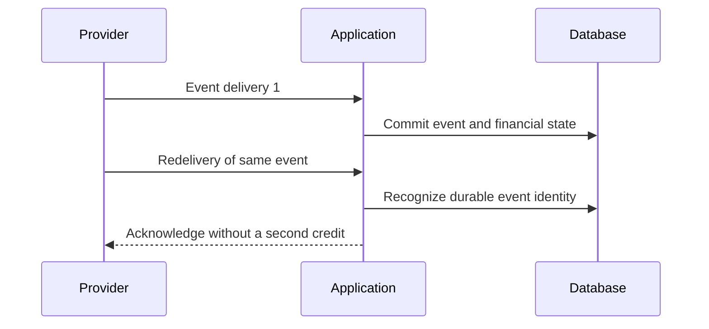

A webhook is an HTTP request sent by one system to another when something
happens. In a payment integration, the provider sends the request to your
backend, not to the customer's browser.

The request usually contains:

- an event identifier;
- an event type;
- a creation timestamp;
- payment or checkout data;
- a signature header that lets your server check authenticity.

## Why webhooks are delivered more than once

Networks fail. A provider may not know whether your server committed the event,
so it can deliver the same event again. Your handler must make a duplicate safe.

## The raw body matters

Signature verification is performed over the exact bytes sent by the provider.
If middleware parses and reserializes JSON first, whitespace or escaping can
change the signed message. Verify the raw body before parsing it. See the
[Bachs signing guide](/bachs/signing).
