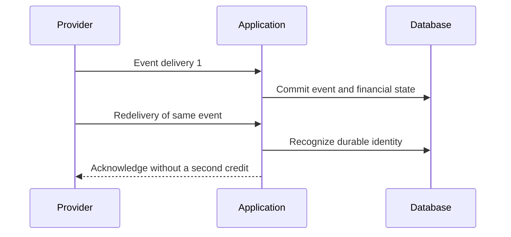

A webhook is an HTTP request sent by one system to another when something
happens. In a payment integration, the provider sends the request to your
backend, not to the customer's browser.

A payment webhook normally contains an event identifier, event type, creation
time, payment or checkout data, and a signature header. The signature is proof
that the sender knew the shared webhook secret; it is not proof that your order
matching or ledger update is correct.

## What your handler should do

For a ₦5,000 deposit, a safe high-level order is:

1. Read the original raw bytes.
2. Verify the signature and timestamp.
3. Parse and validate the event envelope.
4. Find the local order using the reference.
5. Check amount, currency, eligibility, and event ordering.
6. Record event identity and the financial effect atomically.
7. Return a response that matches whether the event was handled or should be
   retried.

## Why deliveries repeat

Networks fail. A provider may not know whether your server committed the event,
so it can deliver the same event again. Your handler must make a duplicate safe.

## The raw body matters

Signature verification is performed over the exact bytes sent by the provider.
If middleware parses and reserializes JSON first, whitespace or escaping can
change the signed message. Verify the raw body before parsing it. See the
[Bachs signing guide](/bachs/signing).
