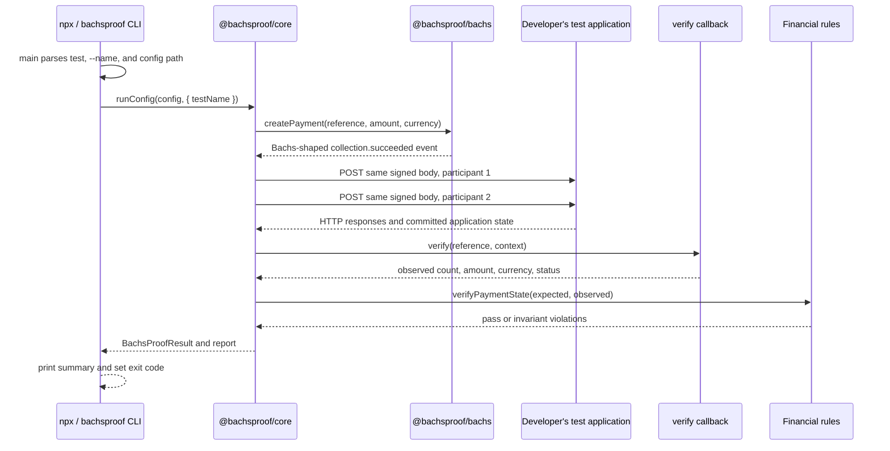

This page follows the exact command:

```bash
npx bachsproof test --name "concurrent duplicate credit"
```

The name is the human-readable `name` in `tests/bachsproof.test.mjs`; the
scenario value behind it is `concurrent-duplicate-credit`. The command must run
from an application repository with an installed `@bachsproof/cli@1.1.0` and
an isolated test application.

## The communication path



When controlled checkpoints are configured, the two POSTs also carry
`x-bachsproof-*` headers. The application checkpoint calls the local
`RaceController`; the core waits for both arrivals and then releases them. The
normal command still works without the SDK, in which case the two POSTs are
ordinary HTTP concurrency.

## Walkthrough, stage by stage

### 1. The shell enters the CLI

`npx` resolves the locally installed `bachsproof` executable. The executable's
`main` function in `packages/cli/src/cli.ts` sees `test`, reads the value after
`--name`, and defaults the config path to `bachsproof.config.mjs`.

Plain English: the CLI has not sent a webhook yet. It has only selected the
configuration file and the one named test.

### 2. Configuration is loaded and checked

`loadConfig` in `packages/cli/src/runner.ts` resolves the path, loads the module
with Jiti, and calls `assertConfig`. The config must contain a provider, a
target with `baseUrl` and `webhookPath`, and at least one test. `runConfig`
filters the list by the exact name `concurrent duplicate credit`.

Plain English: this is where BachsProof learns which adapter to use, where the
test webhook lives, whether signing is enabled, and how to read committed
state. The application server does not import this config.

### 3. The CLI composes Bachs signing

If `config.signing` is present, `withBachsSigning` wraps the adapter. For every
body, it calls `signBachsWebhook` from `packages/bachs/src/signing.ts` and adds
`X-Bachs-Signature-V2`. `headersForBody` signs the exact body that will be sent;
this matters for tampered-body scenarios.

Plain English: signing authenticates the synthetic request to the same test
webhook verifier your application uses. It is a test secret, not a Bachs API
key and not evidence of a live Bachs delivery.

### 4. A real application reference is prepared

`BachsProof.run` in `packages/core/src/orchestrator.ts` first validates the run
options. `preparePaymentReferences` in `packages/core/src/preparation.ts`
keeps an explicit `reference` if supplied. If it is missing, it calls the
configured `createPayment` callback with `scenario`, `amountMinor`, `currency`,
`paymentIndex`, and `paymentCount`.

For the documentation example, use `amountMinor: 500_000` and `currency:
"NGN"` for ₦5,000. The callback should create a fresh isolated application
payment and return its reference. BachsProof does not create a live charge.

Plain English: the application must already know which test payment the incoming
webhook refers to. A made-up reference is not a real payment record.

### 5. The adapter creates the event

For duplicate-credit scenarios, `BachsProof.run` calls the provider's
`createPayment`. `bachsAdapter` in `packages/bachs/src/adapter.ts` delegates to
`createBachsMockFixture` in `packages/bachs/src/fixtures.ts`. The fixture
contains one eligible `collection.succeeded` event, a reference, a decimal
amount in the provider envelope, and normalized integer fields used by the
core.

There is no `createScenario` plan for the three duplicate/unique delivery
scenarios. The core creates one logical event and chooses the delivery schedule
itself. Other scenarios, such as `underpaid-payment`, return a plan from
`createBachsScenario`.

Plain English: the adapter describes what a Bachs-shaped notification looks like;
it does not call Bachs or settle a payment.

### 6. The core chooses concurrency

The core derives the participant count from `concurrency`, the number of
references, or the scenario default. For `concurrent-duplicate-credit`, the
default is two. It calls `deliver` once per participant with the same event.

Without a configured checkpoint, `settleConcurrentDeliveries` uses
`Promise.allSettled`. This starts the deliveries as one wave and retains every
response or error. With a checkpoint configured, the core first registers a
session in `RaceController`, waits for every participant at the named
checkpoint, calls `release`, and then settles the requests.

Plain English: “concurrent” means the requests overlap. It does not mean the
operating system or database is deterministic unless the application opts into
the named checkpoint.

### 7. The body is serialized, signed, and delivered

`deliver` in `packages/core/src/orchestrator.ts`:

1. creates a delivery record with a delivery ID, participant ID, reference,
   event ID, and start time;
2. serializes the event with `provider.serialize`;
3. combines `content-type`, target headers, adapter/signing headers, and
   checkpoint headers;
4. posts the body with `undici.fetch` to `new URL(webhookPath, baseUrl)`; and
5. records the HTTP status, response body, error, and completion time.

Plain English: the request travels through the real test route, including its
signature verification and database code. BachsProof does not bypass the
application handler.

### 8. The application handles both requests

Your application verifies the raw body and signature, parses the event, finds
the prepared payment, applies its idempotency and transaction rules, and
commits or rejects the financial effect. The application controls whether both
requests return `2xx`; BachsProof records what happened.

If controlled mode is active, `checkpointMiddleware` in
`packages/sdk/src/checkpoint.ts` creates a request-scoped context from the
`x-bachsproof-*` headers. A handler's `await checkpoint("after-idempotency-check")`
calls the core controller and pauses until release.

### 9. Financial state is read independently

After delivery, `BachsProof.run` calls `inspect` once for the reference. It
passes the application-supplied `verify` callback a `FinancialVerificationContext`
containing the scenario, expected outcome, related events, event IDs, and
delivery records. The callback must read the committed application state.

`verifyWithCallback` in `packages/core/src/verification.ts` validates the
returned shape with `financialVerificationSchema`. If the callback returns
`pending: true`, it polls until the completion deadline. A callback exception,
wrong reference, malformed amount, or malformed currency is an error; it is not
treated as “still processing.”

Plain English: two `200 OK` responses are not the answer. The verifier asks the
database whether the wallet has one ₦5,000 credit, two credits, no credit, or a
different amount.

### 10. Invariants are evaluated

`verifyPaymentState` in `packages/core/src/invariants.ts` compares the expected
state from the adapter with the normalized observation from the callback. For
this eligible duplicate test, one credit of `500_000` NGN passes; two credits
violate `INV-001` and can also violate `INV-002` and `INV-005`; zero credits
violates `INV-003`.

The comparison uses integer minor units. It does not inspect the database
directly and does not infer records from HTTP responses.

### 11. The report is finalized and the CLI exits

`BachsProof.run` creates the report before network work, appends delivery and
checkpoint traces, stores observations and violations, and sets `completedAt`
in its `finally` block. `runConfig` returns the result to `main`, which prints
the summary. The CLI returns exit code `0` only when there are no errors and all
financial verification results pass; it returns `1` for a failed test.

The report's `financiallyVerified` flag is separate from `passed`. A delivery
can pass while being explicitly marked unverified when no `verify` callback was
configured. Set `requireFinancialVerification: true` when an unverified run
must fail the CLI workflow.

## Source trace

| Stage | Actual implementation | Responsibility |
| --- | --- | --- |
| Command parsing | `packages/cli/src/cli.ts:main`, `valueAfter`, `has` | Select command, config path, and test name |
| Config loading | `packages/cli/src/runner.ts:loadConfig`, `assertConfig` | Import and validate the module |
| Test selection | `packages/cli/src/runner.ts:runConfig` | Filter by exact `name`, enforce required verification |
| Signing | `packages/cli/src/runner.ts:withBachsSigning` and `packages/bachs/src/signing.ts:signBachsWebhook` | Sign the exact request body |
| Reference preparation | `packages/core/src/preparation.ts:preparePaymentReferences` | Call `createPayment` when needed |
| Event creation | `packages/bachs/src/adapter.ts:bachsAdapter` and `fixtures.ts:createBachsMockFixture` | Build a local Bachs-shaped event |
| Delivery schedule | `packages/core/src/orchestrator.ts:BachsProof.run` | Select sequential, concurrent, or controlled delivery |
| HTTP delivery | `packages/core/src/orchestrator.ts:deliver` | Serialize, header, POST, and record outcome |
| Checkpoint barrier | `packages/core/src/race-controller.ts:RaceController` | Register, wait, release, abort, and trace participants |
| Callback polling | `packages/core/src/orchestrator.ts:inspect` and `verification.ts:verifyWithCallback` | Read and validate committed state |
| Financial rules | `packages/core/src/invariants.ts:verifyPaymentState` | Evaluate `INV-001` through `INV-005` |
| Report and exit | `BachsProof.run`, `packages/cli/src/cli.ts:main` | Finalize report and return status |

<Note>
The exact line numbers can move between releases. The file and function names
above are the implementation contract for version `1.1.0`.
</Note>
