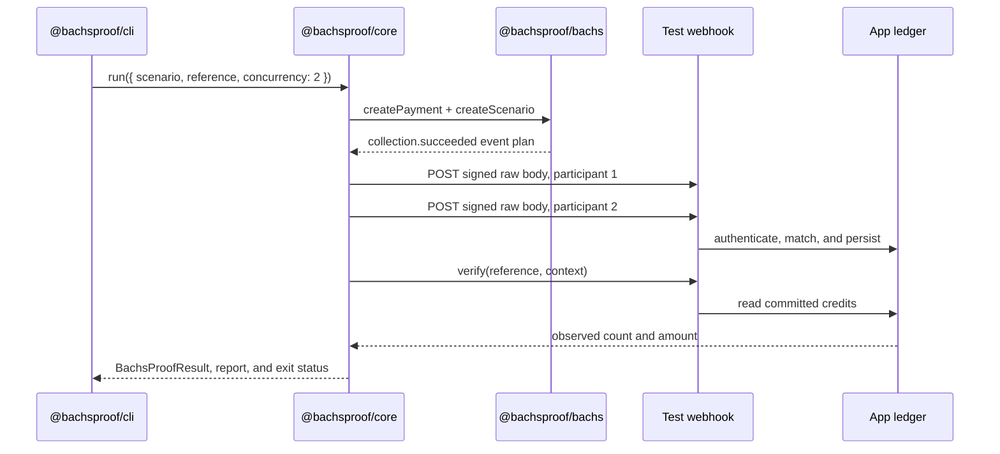

Every run follows the same broad path. The example below is a
`concurrent-duplicate-credit` run for a ₦5,000 wallet deposit.

<Steps>
  <Step title="Select a scenario">
    The CLI's `runConfig` selects every configured test, or one exact test when
    `--name` is used. Programmatic callers pass a `RunOptions` object to
    `runner.run()`.
  </Step>
  <Step title="Prepare references">
    Manual references take precedence. Synthetic references are allowed only
    when explicitly enabled. Otherwise `preparePaymentReferences` calls
    `createPayment` for each required payment and validates the returned
    strings.
  </Step>
  <Step title="Create the provider plan">
    `@bachsproof/bachs` runs `createBachsScenario` for lifecycle scenarios. It
    describes event bodies, order, concurrency, expected HTTP status, and the
    event whose state should be checked. Duplicate-credit tests use core's
    ordinary one-event delivery paths.
  </Step>
  <Step title="Serialize, sign, and deliver">
    `BachsProof.deliver` serializes the event, signs the exact body when signing
    is configured, and sends it to `baseUrl + webhookPath`. Concurrent
    deliveries are settled with `Promise.allSettled`, so every delivery error
    remains visible. A normal HTTP response is not yet a financial pass.
  </Step>
  <Step title="Observe committed state">
    If `verify` is configured, `BachsProof.inspect` calls it with each relevant
    reference and context. It polls while the callback returns `pending: true`,
    and waits through the negative observation window for an ineligible event.
  </Step>
  <Step title="Evaluate, report, and exit">
    The runner normalizes the callback result, applies the five invariants, and
    records deliveries, errors, checkpoints, and timing. The CLI prints the
    summary and returns exit code `0` only when every selected result passes;
    otherwise it returns `1`.
  </Step>
</Steps>

Expected state is diagnostic input to the comparison. It never replaces an
observation from the application. The implementation files for this path are
`packages/cli/src/runner.ts`, `packages/core/src/preparation.ts`,
`packages/core/src/orchestrator.ts`, `packages/core/src/verification.ts`, and
`packages/core/src/invariants.ts`.

## File and function trace

| Stage | Actual implementation | What it does |
| --- | --- | --- |
| CLI argument parsing | `packages/cli/src/cli.ts:main`, `valueAfter`, `has` | Reads `init`, `test`, `--config`, `--name`, and `--json` |
| Config loading | `packages/cli/src/runner.ts:loadConfig`, `assertConfig` | Loads the module with Jiti and checks provider, target, and non-empty tests |
| Test selection | `runConfig` | Filters by exact test name and checks `requireFinancialVerification` |
| Bachs signing composition | `withBachsSigning` | Adds `headers` and `headersForBody` using `signBachsWebhook` |
| Reference selection | `preparePaymentReferences` | Gives manual references priority, then synthetic mode, then `createPayment` |
| Reference validation | `validateRunOptions`, `runConfig` | Checks non-empty, distinct, and correctly counted references |
| Scenario construction | `BachsProof.run`, adapter `createScenario` | Creates the event or ordered/concurrent provider plan |
| Event and expected state | `provider.createPayment`, `provider.expectedState` | Builds the provider object and core comparison state |
| Body delivery | `BachsProof.deliver` | Serializes, builds headers, posts with `undici.fetch`, and records the result |
| Concurrency | `settleConcurrentDeliveries` | Uses `Promise.allSettled` so one request cannot hide another error |
| Financial observation | `BachsProof.inspect`, `verifyWithCallback` | Calls `verify`, validates its shape, polls, and applies deadlines |
| Invariant evaluation | `verifyPaymentState` | Checks `INV-001` through `INV-005` against the normalized observation |
| Report finalization | `BachsProof.run` `finally` block | Adds completion time, checkpoint trace, errors, and per-payment results |
| CLI exit status | `main` | Returns `1` when any selected `result.passed` is false, otherwise `0` |

For a controlled duplicate test, `RaceController.registerSession` creates an
HTTP session before delivery. The SDK's `checkpoint` posts each participant's
arrival; `waitForArrivals` resolves when the configured count is present;
`release` completes held HTTP responses; and `cleanupSession` runs in the
orchestrator's `finally` block. This is the complete synchronization path, not
an assertion that arbitrary database scheduling became deterministic.
