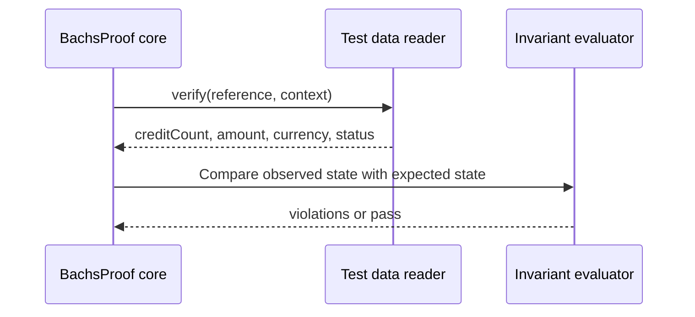

The `verify` callback is the bridge between BachsProof and your application's
financial records. BachsProof calls it with the reference it just tested. Your
callback reads committed data and returns a normalized observation. This is why
BachsProof can work with Prisma, SQL, an in-memory store, or a service owned by
another language: only your test code needs to know the schema.



## What the callback returns

```ts
{
  reference: "wallet-deposit-001",
  creditCount: 1,
  creditedAmountMinor: 500_000,
  currency: "NGN",
  status: "COMPLETED",
  pending: false,
  ledgerEntries: [
    { id: "credit-1", type: "CREDIT", amountMinor: 500_000, currency: "NGN" }
  ]
}
```

`creditCount`, `creditedAmountMinor`, and `currency` are required. `status`,
`pending`, and `ledgerEntries` are optional. `500_000` is ₦5,000 at two decimal
places. Read the rows your application committed; do not calculate an answer
from the event BachsProof sent.

The callback may have one argument for compatibility:

```ts
verify(reference)
```

Or it may use the second argument:

```ts
verify(reference, context)
```

The context contains the scenario, expected outcome, related event objects and
identifiers, and delivery records. It is useful for logging and selecting the
right test read, but the expected outcome is not evidence. Returning
`context.expectedOutcome.expectedCreditCount` would simply repeat BachsProof's
expectation and could hide a missing credit.

## Asynchronous processing

Some handlers enqueue a job and return before the worker writes the ledger. In
that case return `pending: true` while the job is still in flight:

```js
return {
  reference,
  creditCount: state.credits.length,
  creditedAmountMinor: state.creditedAmountMinor,
  currency: state.currency,
  status: state.status,
  pending: state.workerStatus === "PROCESSING"
};
```

BachsProof polls every `pollIntervalMs` until `completionDeadlineMs`. A callback
error or malformed callback result fails immediately because it is not treated
as “not ready.” Negative scenarios use `negativeObservationWindowMs`, so an
immediate zero is not treated as proof that a late worker can never create a
credit. At the end of the window, zero credits are the observation being
checked, not a claim about all future time.

The core first validates the callback with `financialVerificationSchema`, then
`verifyPaymentState` evaluates the five rules. The implementation is in
`packages/core/src/verification.ts` and `packages/core/src/invariants.ts`.
