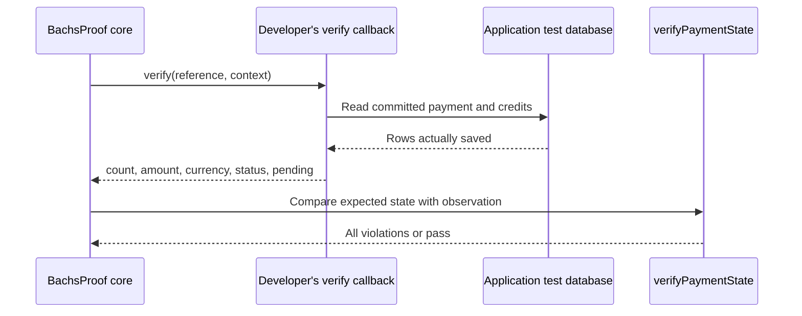

HTTP tells BachsProof whether a request received a response. It does not tell
BachsProof what your application committed. Financial verification is the
second read: your callback looks up the payment and its credit or ledger rows,
then returns a small provider-neutral summary.



## Why BachsProof cannot read the database for you

Every application stores money differently. One wallet may use `WalletCredit`,
another may use a double-entry ledger, and another may call an internal service.
BachsProof does not know your connection string, schema, transaction boundary,
or which rows represent a completed credit. It would be unsafe to guess.

The callback is therefore an explicit trust boundary: it must read committed
state from the same isolated environment that handled the webhook. It must not
repeat the expected result supplied in `context`.

## The normalized observation

```ts
return {
  reference: "wallet-deposit-001",
  creditCount: 1,
  creditedAmountMinor: 500_000,
  currency: "NGN",
  status: "COMPLETED",
  pending: false,
  ledgerEntries: [
    { id: "credit-1", type: "CREDIT", amountMinor: 500_000, currency: "NGN" }
  ]
};
```

Read the example from top to bottom:

1. `reference` identifies the application payment BachsProof asked about. It
   must equal the callback argument.
2. `creditCount` is the number of committed credit records for that payment.
   It is how duplicate-credit checks distinguish one row from two.
3. `creditedAmountMinor` is the integer total actually credited. `500_000` NGN
   minor units is ₦5,000 at two decimal places.
4. `currency` says which currency those records use. `NGN` and `USD` are not
   interchangeable just because their numeric amounts look alike.
5. `status` is an optional application status shown in normalized reports.
6. `pending` is an optional application signal. `true` means the worker has
   not finished enough for a financial conclusion; it does not mean “passed.”
7. `ledgerEntries` is optional detail for reports and debugging. The core uses
   the normalized count, aggregate, and currency fields for the five rules.

The runtime schema in `packages/core/src/verification.ts` rejects an empty
reference, negative or fractional counts, negative or fractional amounts,
malformed currencies, and malformed ledger entries. A wrong reference is also
rejected after parsing.

## Expected state versus observed state

The adapter supplies **expected** state. For an eligible ₦5,000 event it is:

```ts
{
  reference: "wallet-deposit-001",
  eligible: true,
  amountMinor: 500_000,
  currency: "NGN",
  expectedCreditCount: 1
}
```

Your callback supplies **observed** state. For example:

| Observation | Meaning | Result |
| --- | --- | --- |
| `creditCount: 1`, `500_000 NGN` | One correct committed credit | Pass |
| `creditCount: 2`, `1_000_000 NGN` | The same payment was credited twice | `INV-001`, plus aggregate failures |
| `creditCount: 0`, `0 NGN` | Nothing was credited for an eligible payment | `INV-003` |
| `creditCount: 1`, `499_900 NGN` | A credit exists, but it is ₦4,999 | `INV-002` and possibly `INV-005` |
| `creditCount: 1` for an ineligible event | An expired, invalid, or underpaid event created money | `INV-004` |

`verifyPaymentState` in `packages/core/src/invariants.ts` compares those two
objects. It does not assume that HTTP `200`, a provider event ID, or an order
status proves that a credit exists.

## A verifier for asynchronous applications

The verifier can use one argument for compatibility or accept the optional
context for diagnostics:

```ts
export async function verify(reference: string, context?: FinancialVerificationContext) {
  const payment = await testDb.payment.findUnique({ where: { reference } });
  const credits = await testDb.walletCredit.findMany({ where: { reference } });

  const unfinished = new Set([
    "QUEUED",
    "WAITING",
    "PROCESSING",
    "RETRY_SCHEDULED",
    "RETRYING"
  ]);

  return {
    reference,
    creditCount: credits.length,
    creditedAmountMinor: credits.reduce((sum, credit) => sum + credit.amountMinor, 0),
    currency: payment?.currency ?? "NGN",
    status: payment?.status ?? "NOT_FOUND",
    pending: payment?.workerStatus !== undefined && unfinished.has(payment.workerStatus),
    ledgerEntries: credits.map((credit) => ({
      id: credit.id,
      type: credit.type,
      amountMinor: credit.amountMinor,
      currency: credit.currency
    }))
  };
}
```

Line by line:

- The callback receives the exact reference BachsProof is checking. `context`
  may help logging, but it is not the source of truth.
- The two queries read the payment and committed credits from the test store.
  Replace these field names with your application's actual schema.
- `unfinished` lists application-specific worker states that are not yet a
  financial conclusion. The framework does not define these strings; your
  queue does.
- `creditCount` counts saved rows, not delivered webhooks.
- `creditedAmountMinor` sums the committed integer amounts.
- The fallback currency and status describe a missing record; they must not be
  mistaken for a successful credit.
- `pending` is true only while a known unfinished worker state remains. A
  failed job should normally be `pending: false`, allowing the invariants to
  report missing or unexpected state.
- `ledgerEntries` gives the report useful evidence without making BachsProof
  understand the application's tables.

Do not use `context.expectedOutcome`, a hardcoded `0`, or a hardcoded `1` as the
result. That would only echo the test's expectation and could hide a bug.

## Polling and observation windows

`BachsProof.inspect` uses these defaults:

| Option | Default | Purpose |
| --- | ---: | --- |
| `completionDeadlineMs` | `10_000` | Maximum time to wait for an eligible result |
| `pollIntervalMs` | `25` | Delay between callback reads while `pending` is true |
| `negativeObservationWindowMs` | `250` | Minimum bounded observation for an ineligible event with no credit |

For an eligible event, BachsProof stops when the callback is no longer pending
and the expected financial state passes, or fails at the completion deadline.
For an ineligible event, a detected credit fails immediately; if there is no
credit, BachsProof waits through the negative window before accepting the
no-credit observation. That is a bounded test observation, not a proof that a
future job can never write a row.

The implementation is intentionally conservative: callback errors and malformed
values fail immediately, while `pending: true` is the explicit signal for work
that is still in flight.
