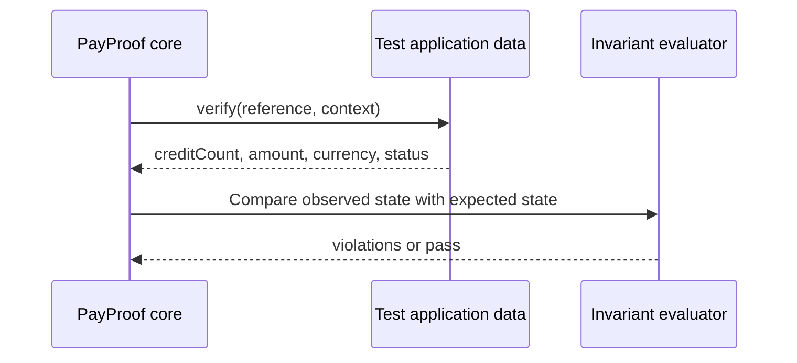

The `verify` callback is the bridge between PayProof and your application’s
financial records. PayProof calls it with the reference it just tested. Your
callback reads committed data and returns a normalized observation.



The callback may have one argument for compatibility:

```ts
verify(reference)
```

Or it may use the second argument:

```ts
verify(reference, context)
```

The context contains the scenario, expected outcome, event identifiers, event
objects, payment reference, and delivery records. It is useful for logging and
selecting the right test read, but the expected outcome is not evidence.

If processing is asynchronous, return `pending: true` until committed state is
ready. PayProof polls until `completionDeadlineMs`. Negative scenarios use a
bounded observation window so an immediate zero is not treated as proof that a
late worker can never create a credit.
