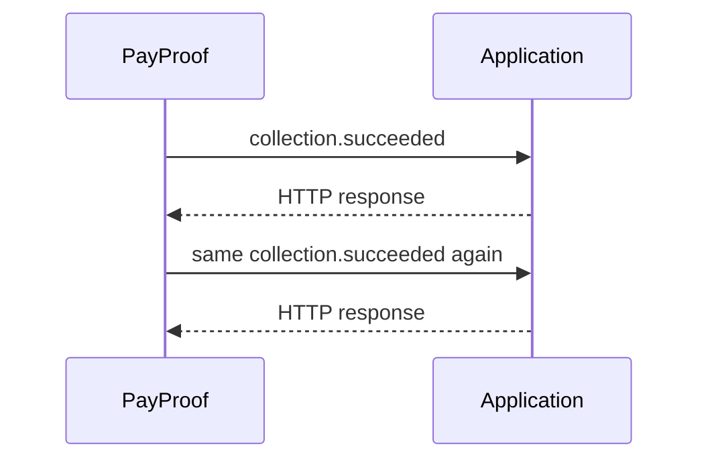

## In plain English

The same payment notification arrives twice, one after the other. The customer
paid once, so the application must credit once.

## What PayProof does

The Bachs adapter creates one eligible `collection.succeeded` event. The core
delivers the same serialized event twice, sequentially, with the same event ID.



## Expected result

The verifier should observe one credit for the expected amount and currency.
The main rule is `INV-001`; amount checks use `INV-002`, `INV-003`, and `INV-005`.

```js
{ name: "sequential duplicate", scenario: "sequential-duplicate-webhook" }
```

This detects missing event/payment idempotency. It does not test simultaneous
database reads; use [concurrent duplicate credit](/scenarios/concurrent-duplicate-credit)
for that.
