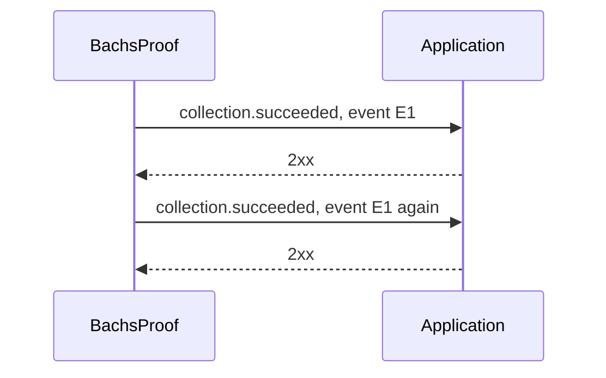

## What problem does it test?

Providers retry when delivery is uncertain. A customer deposited ₦5,000 once,
so two sequential deliveries of the same successful notification must still
produce one `500_000`-kobo credit.

## What BachsProof sends

`createBachsMockFixture` creates one eligible `collection.succeeded` event. The
core serializes and sends that exact event twice, in order, with the same event
ID and reference:



## What the application should do

Persist event identity or an equivalent durable idempotency key. The second
delivery should be acknowledged or otherwise handled according to the route's
contract, but it must not create a second financial effect.

## Expected outcome and failure

Passing state is one ₦5,000 credit in NGN. Two credits fail `INV-001`; the
aggregate can also fail `INV-002` and `INV-005`. Missing credit fails `INV-003`.
Without `verify`, a passing HTTP result is delivery-only.

```js
{
  name: "sequential ₦5,000 duplicate",
  scenario: "sequential-duplicate-webhook",
  amountMinor: 500_000,
  currency: "NGN",
  reference: "prepared-payment"
}
```

## Internal implementation

The sequential branch of `BachsProof.run` in
`packages/core/src/orchestrator.ts` calls `deliver` for `sequential-1`, waits,
then calls it for `sequential-2`. The base event comes from
`createBachsMockFixture` in `packages/bachs/src/fixtures.ts`; no provider API is
called.
