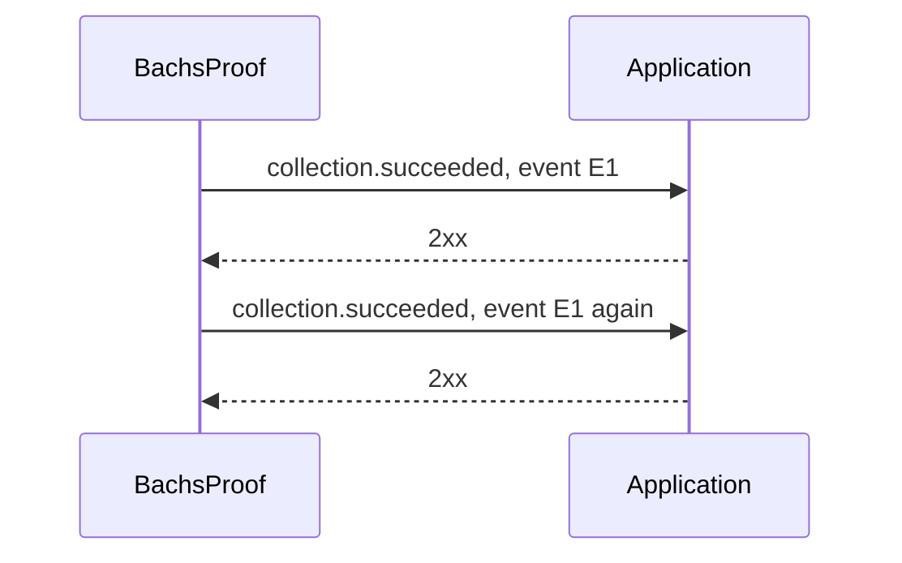

## What problem does it test?

Providers retry when delivery is uncertain. The same successful notification
must not credit a wallet twice. For a ₦5,000 deposit, two deliveries should
still result in one `500_000`-kobo credit.

## What BachsProof sends

`createBachsMockFixture` creates one eligible `collection.succeeded` event.
The core serializes and delivers the same event twice, in order, with the same
event ID. Both deliveries normally expect a 2xx response.



## Expected result and failure

The application should commit one credit for the expected amount and currency.
Two credits fail `INV-001`; the aggregate may also fail `INV-002` and `INV-005`.
Missing credit fails `INV-003`. A delivery error or unexpected status fails the
HTTP part before financial evaluation.

```js
{
  name: "sequential ₦5,000 duplicate",
  scenario: "sequential-duplicate-webhook",
  amountMinor: 500_000,
  currency: "NGN"
}
```

The implementation path is `BachsProof.run` and its sequential branch in
`packages/core/src/orchestrator.ts`; the base event is made by
`createBachsMockFixture` in `packages/bachs/src/fixtures.ts`.
