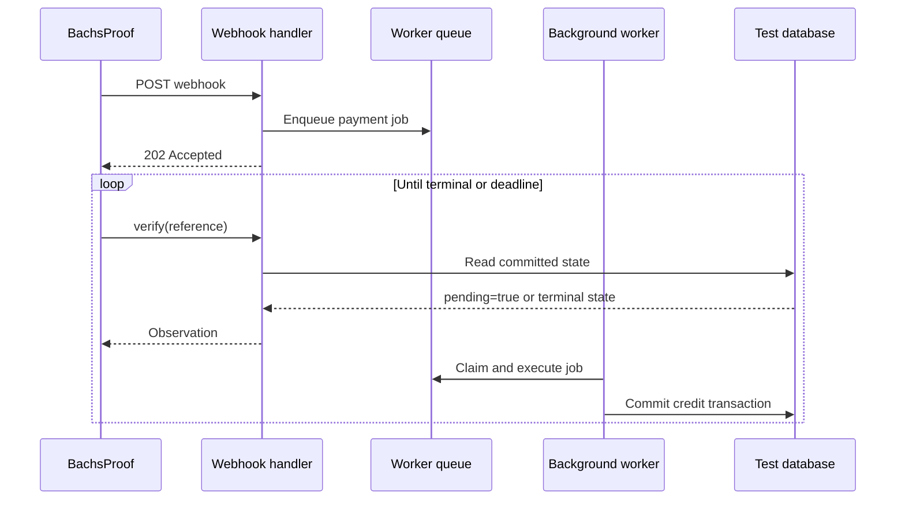

Many webhook handlers do not write the ledger inside the HTTP request. They
validate and enqueue a job, return `202 Accepted`, and let a worker perform the
database transaction later. That architecture is reasonable, but an immediate
database read can confuse “not finished yet” with “nothing will ever happen.”

This is **eventual consistency**: the webhook request finishes first, and the
financial record becomes visible later. **Polling** means reading the state
again after a short wait. BachsProof polls your `verify` callback; it does not
poll Bachs or guess what your worker is doing.

## Return pending for every unfinished worker state

The old one-state pattern is too narrow:

```js
pending: state.workerStatus === "PROCESSING"
```

It says a queued, waiting, scheduled-retry, or retrying job is already complete.
The framework does not define your queue's status strings; your verifier must
map all of the states that mean “this job may still change financial state.”

```js
const unfinishedWorkerStates = new Set([
  "QUEUED",
  "WAITING",
  "PROCESSING",
  "RETRY_SCHEDULED",
  "RETRYING"
]);

export async function verify(reference) {
  const state = await readCommittedState(reference);
  const workerStatus = state.workerStatus;

  return {
    reference,
    creditCount: state.credits.length,
    creditedAmountMinor: state.creditedAmountMinor,
    currency: state.currency,
    status: state.status,
    pending: !state.paymentExists || unfinishedWorkerStates.has(workerStatus),
    ledgerEntries: state.credits
  };
}
```

Line by line:

- `unfinishedWorkerStates` is an application-owned list. Add every state in
  your queue that can still lead to a write. Remove names that are terminal in
  your system.
- `readCommittedState` must read the same isolated store used by the worker.
- The credit count and amount are the rows that exist at this poll, not a
  prediction of the eventual result.
- `pending` is true when the payment record is not visible yet or the worker is
  in an unfinished state. If your application has a different meaning for a
  missing payment, adjust that branch explicitly.
- A terminal `FAILED`, `CANCELLED`, or `COMPLETED` state should normally return
  `pending: false`; the invariants can then report missing or unexpected money.

This is a documentation example, not a built-in status enum. BachsProof only
receives the boolean `pending` field.

## What happens after HTTP 202?

The application has acknowledged the request, but the financial work is not
finished:



An immediate `creditCount: 0, pending: false` can be misleading if the worker
was still queued. Returning `pending: true` tells BachsProof to poll instead of
declaring an eligible payment missing too early.

## Deadlines and intervals

Configure the timing for the slowest normal test worker:

```js
financialVerification: {
  completionDeadlineMs: 10_000,
  pollIntervalMs: 25,
  negativeObservationWindowMs: 250
}
```

- `completionDeadlineMs` is the maximum time `verifyWithCallback` waits for a
  complete observation. The default is `10_000` ms.
- `pollIntervalMs` is the delay between reads while the callback returns
  `pending: true`. The default is `25` ms.
- `negativeObservationWindowMs` is used for an ineligible event when the
  callback is not pending and no credit is present. The default is `250` ms.
  It gives a queued erroneous job a short chance to appear; it is not a
  permanent guarantee.

### A timing example

```text
0 ms       webhook returns 202; worker job is queued
25 ms      verify reads pending=true; BachsProof waits and polls again
100 ms     worker commits one ₦5,000 credit
125 ms     verify reads pending=false and one credit; eligible test can pass
```

For a negative test, the meaning is different:

```text
0 ms       an incomplete checkout is accepted; no credit is visible
250 ms     the negative observation window ends with no credit; INV-004 passes
afterward  a later credit could still appear; the test cannot rule that out
```

The completion deadline is the maximum time allowed for an eligible result to
become complete. The negative observation window is the shorter waiting period
used to look for an unexpected credit. They answer different questions.

For an eligible event, the core stops when `pending` is false and the expected
financial state passes, or when the completion deadline expires. For an
ineligible event, a detected credit is enough to finish with a failure; no
credit is accepted only after the negative window. A callback exception or
malformed result fails immediately instead of being interpreted as “not ready.”

## Is the default window sufficient?

It is sufficient for a fast local worker and the reference wallet's tests, but
it is not a universal queue SLA. Ten seconds may be too short for a CI-shared
database, cold worker startup, scheduled retries, or a deliberately delayed
queue. Set a longer `completionDeadlineMs` when the application requires it and
keep `pollIntervalMs` large enough not to overload the test database.

The `250` ms negative window is intentionally short. Increase it only when an
ineligible request can legitimately enter a queue before the application
decides not to credit it. Do not treat a passing bounded observation as proof
that a future retry can never create a credit.

## What BachsProof cannot observe

BachsProof observes the callback until its deadline. It cannot see a worker that
starts later, a delayed message that is not yet visible, or a future retry after
the window. A passing asynchronous test therefore means “the expected committed
state was observed within the configured window,” not “this application can
never write an incorrect credit later.”

The polling behavior is implemented by `verifyWithCallback` in
`packages/core/src/verification.ts`; deadline selection and the negative
window are implemented by `BachsProof.inspect` in
`packages/core/src/orchestrator.ts`. This page changes no framework behavior.

The runner stops waiting when its deadline is reached, but JavaScript cannot
force-stop arbitrary callback code that is still running. Keep the callback
query bounded and make it read the same committed test database used by the
worker.

<Note>
The existing `workerStatus === "PROCESSING"` example was incomplete for
applications with queued or retryable states. The framework's boolean callback
contract is correct; the application-specific status mapping must include every
unfinished state.
</Note>
