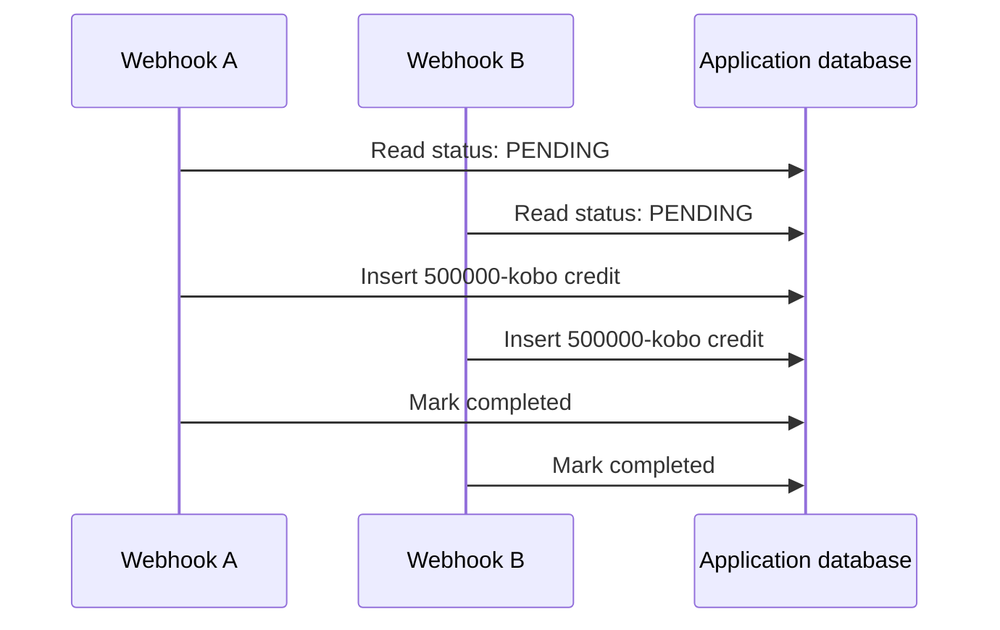

# Why BachsProof exists

**Beyond webhook delivery. Verify financial correctness.**

A webhook can be delivered and acknowledged successfully while the application
still credits a wallet twice, accepts the wrong amount, fulfils an ineligible
payment, or leaves its ledger inconsistent. BachsProof focuses on the financial
consequences of the payment event inside your application.

## Three complementary testing layers

These layers answer different questions. They work together; BachsProof does
not replace either conventional application tests or Bachs' own tools.

| Layer | Main question | Typical tools | What BachsProof adds |
| --- | --- | --- | --- |
| Conventional application testing | Does this handler or service behave correctly for the cases I arrange? | Vitest, Jest, fixtures, mocks, database tests | Reusable payment scenarios and financial outcome checks |
| Provider integration and webhook testing | Does my integration use Bachs' documented checkout, webhook, signature, and provider flows correctly? | Official Bachs SDK, sandbox, Developer Portal, CLI, and webhook tooling | A compatible application-side test target for the next layer |
| Application-side financial correctness testing | After payment events reach my handler, did my application commit the right financial state? | BachsProof CLI or programmatic runner with `createPayment` and `verify` callbacks | Controlled synthetic events, duplicate/concurrent schedules, verification polling, and five financial invariants |

Conventional frameworks can implement equivalent tests manually. BachsProof is
useful when a team wants reusable payment-specific event construction, delivery
schedules, expected payment outcomes, and report identifiers without rebuilding
that infrastructure for every application.

## The duplicate-credit story

Suppose a customer deposits **₦5,000** (`500_000` NGN minor units). A vulnerable
handler performs this sequence:

```text
read payment status -> if not completed -> create credit -> mark completed
```

Now two identical requests overlap:



The endpoint can return two successful responses while the wallet is wrong by
₦5,000. BachsProof makes that delivery pattern observable and, with `verify`,
checks the committed credit rows. The callback is necessary because BachsProof
does not know whether your application stores money in a wallet table, a ledger,
an order record, or another system.

## Use BachsProof alongside Bachs tools

The official Bachs documentation covers provider integration, checkout creation,
webhook setup and signature verification, sandbox development, local forwarding,
and provider event replay. Use those tools to establish that the provider-side
flow and your webhook boundary work as documented.

Use BachsProof after that boundary to send deterministic synthetic events to an
isolated application and inspect the state produced by your own handler. It can
test application-specific payment matching, idempotency, transaction behaviour,
ledger recording, and wallet crediting. It does not claim to recreate a live
checkout or provider settlement.

See the official [Bachs webhook guide](https://docs.bachs.io/guides/webhooks/overview),
[local webhook testing guide](https://docs.bachs.io/developer-portal/local-testing),
and [checkout guide](https://docs.bachs.io/guides/checkout/checkout-sessions) for
provider-side workflows.

## Why ordinary tests may miss it

A unit test usually calls the handler once. An ordinary integration test often
sends requests one after another. Both can prove that the happy path works
without creating the dangerous interleaving.

BachsProof can send duplicate deliveries concurrently. Optional checkpoint
instrumentation can pause both requests after the same application read and
release them together. That is deeper application testing, not a replacement
for your normal unit and integration suite.

## What it is not

BachsProof is not a gateway, a webhook relay, a Bachs account, or a provider
sandbox. It does not move money, create live payment objects, deliver real
provider retries, or inspect your database automatically. It sends synthetic
requests to the test endpoint you configure.

## Who should use it?

BachsProof is useful for teams that credit wallets, fulfil orders, or persist
payment and ledger records from webhooks. The target may be Express, TypeScript,
Go, Python, or another HTTP backend. BachsProof needs an HTTP endpoint and, for
financial verification, a test-side callback that can read committed state.

Your team remains responsible for authentication, order matching, durable
idempotency, event ordering, transaction boundaries, reconciliation, database
isolation, and production readiness.
