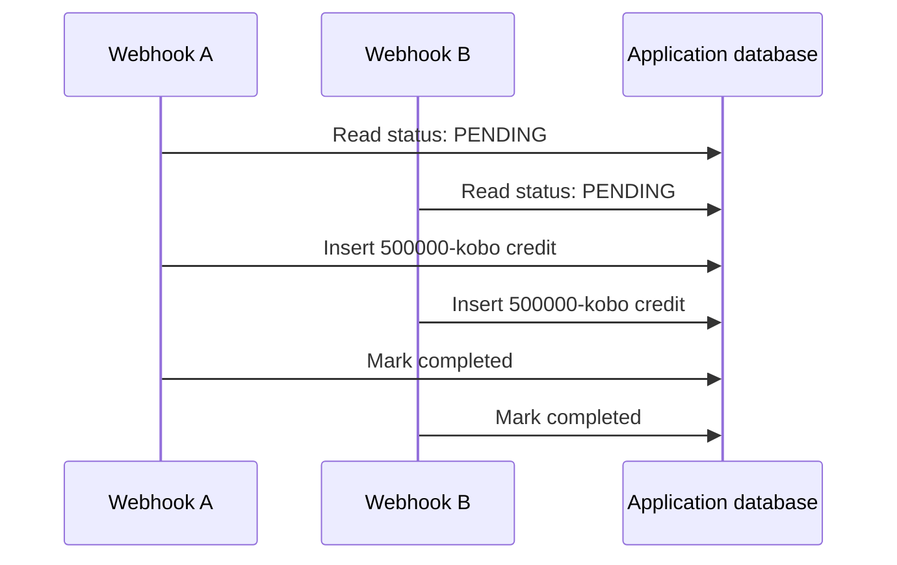

# Why BachsProof exists

Payment systems have two different kinds of success:

1. **Transport success:** the webhook endpoint received and acknowledged a
   request.
2. **Financial success:** the application committed the correct financial state.

The first is useful, but it is not proof of the second.

## The duplicate-credit story

Suppose a customer deposits ₦5,000. Your handler performs this sequence:

```text
read payment status -> if not completed -> create credit -> mark completed
```

Now two identical requests overlap:



The endpoint can return two successful responses while the wallet is wrong by
₦5,000. BachsProof makes the duplicate delivery observable and, with `verify`,
checks the committed credit rows.

## Why normal tests miss it

A unit test usually calls the handler once. An ordinary integration test often
sends requests one after another. Both can prove that the happy path works
without creating the dangerous interleaving.

BachsProof can send duplicate deliveries concurrently. Optional checkpoint
instrumentation can pause both requests after the same application read and
release them together. That is deeper testing, not a requirement for normal
black-box use.

## Who should use it?

BachsProof is useful for teams that credit wallets, fulfil orders, or persist
payment/ledger records from webhooks. The target may be Express, TypeScript,
Go, Python, or another HTTP backend. BachsProof needs an HTTP endpoint and, for
financial verification, a test-side callback that can read committed state.

Your team remains responsible for authentication, order matching, durable
idempotency, event ordering, transaction boundaries, reconciliation, database
isolation, and production readiness.
