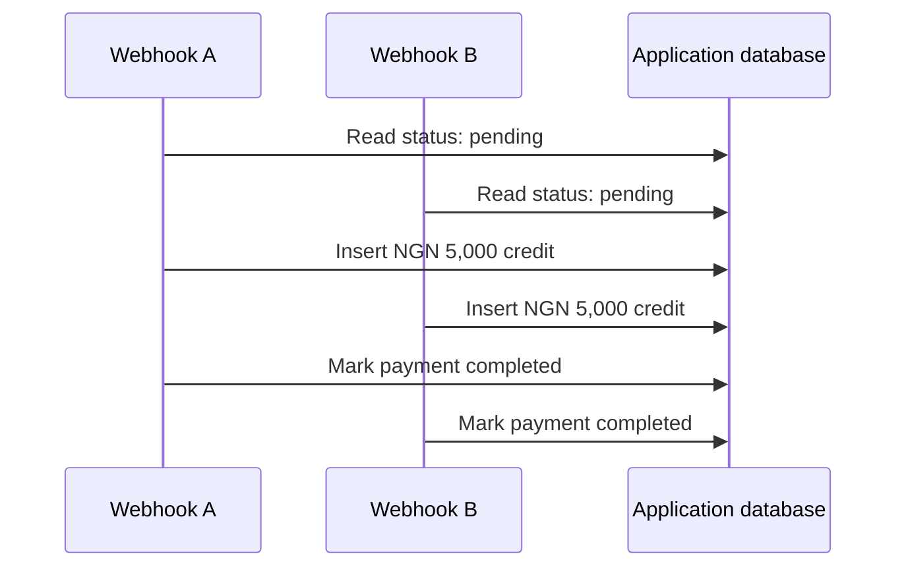

# Why PayProof exists

Payment systems have two different kinds of success:

1. **Transport success:** the webhook endpoint received and acknowledged a
   request.
2. **Financial success:** the application committed the correct financial state.

The first is useful, but it is not proof of the second.

## The duplicate-credit story

Suppose a customer has paid NGN 5,000. Your webhook handler performs this
sequence:

```text
read payment status → if not completed → create credit → mark completed
```

Now two identical requests run at once:



The endpoint may return two successful responses. The wallet is wrong by NGN
5,000.

## Why normal unit tests miss it

A unit test usually calls the handler once. An ordinary integration test often
sends requests one after another. Both tests can prove that the happy path
works while never creating the dangerous interleaving.

PayProof can send duplicate deliveries concurrently. With optional checkpoint
instrumentation, it can also pause both requests after the same application
read and release them together. The checkpoint mode is deeper testing, not a
requirement for normal black-box use.

## Who should use PayProof?

PayProof is useful for teams that:

- credit wallets or balances from payment webhooks;
- fulfil orders after payment confirmation;
- persist payment, ledger, or event records;
- want a repeatable test suite for idempotency and event ordering;
- already have an Express, TypeScript, or other HTTP backend.

The target application may be written in another language. PayProof only needs
an HTTP webhook endpoint and, for financial verification, a test-side callback
that can read committed state.

## Responsibility boundary

PayProof assists with testing. Your team remains responsible for transaction
boundaries, durable idempotency, authentication, event ordering, reconciliation,
database isolation, and production readiness.
